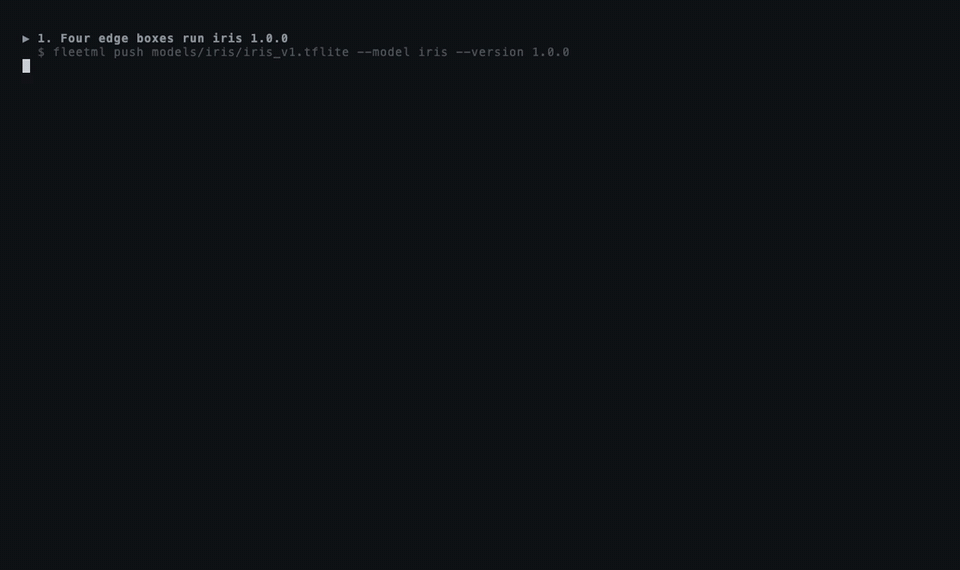

# FleetML

Ship ML models to phones and edge devices in stages, watch how each version
behaves, and roll back automatically when one is worse.

[](https://github.com/fleetml/fleetml/actions/workflows/ci.yml)

## Why

Getting a model file onto phones and edge devices is the easy part. Taking a
bad version back from the devices that already have it, before every device
has it, is not, so teams that run models on devices end up building staged
rollouts, rollback and drift monitoring themselves.

The hosted options are going away: Firebase ML, including its custom model
hosting, is deprecated and shuts down on June 15, 2027
([Firebase docs](https://firebase.google.com/docs/ml/manage-hosted-models)),
and SageMaker Edge Manager was discontinued in 2024
([AWS docs](https://docs.aws.amazon.com/sagemaker/latest/dg/edge-eol.html)).

FleetML is self-hosted and Apache-2.0, and works with any model file. Devices
verify each download and keep the previous version if the new one does not
load. Your app runs the model with its own runtime.

**What FleetML is not.** It is not an inference runtime: your app or inference
process keeps running the model with the runtime you already use, so nothing
about inference changes. It is not a model trainer or converter: it starts
from a file you already have, in any format. And it is not a hosted service:
you run the server, its Postgres, NATS and object store yourself, with Docker
Compose or the Helm chart, so your models and telemetry never leave your
infrastructure.

## The 60-second story



Above, [`scripts/demo-agent.sh`](scripts/demo-agent.sh): four
[Linux device agents](docs/LINUX_AGENT.md) run iris 1.0.0, a canary of 2.0.0
reaches some of them, their inference process reports errors, the health gate
rolls the release back, and the canary boxes switch back to 1.0.0 without a
download (35 seconds, then the dashboard). The GIF is regenerated by
[`docs/screenshots/demo/record.sh`](docs/screenshots/demo/record.sh).

[`scripts/demo.sh`](scripts/demo.sh) tells the longer story against a real
server and twenty simulated devices that use the same protocol as the SDKs
(needs Docker, Go and jq; 55 seconds with the images and Go modules cached,
a few minutes more on a first run, which pulls and downloads them):

```text
▶ 1. Publish three versions of a model
  ✓ Pushed models/iris/iris_v1.tflite → iris v1.0.0 (INT8)          (2.0.0 and 2.1.0 too)
▶ 2. Twenty devices enroll and get 1.0.0
  fleet: iris 1.0.0 on 20
▶ 3. Drift: the last day's latency against the week before
  latency drift for 1.0.0: NONE (PSI 0.044)
  now the devices slow down (say, after an OS update)...
  latency drift for 1.0.0: CRITICAL (PSI 8.511)
  a change into CRITICAL is sent as an alert: 1 drift alert(s) on NATS
▶ 4. A canary of 2.0.0 with a health gate; 2.0.0 is broken
  fleet: iris 1.0.0 on 11, iris 2.0.0 on 9   (the canary cohort only)
  deployment ROLLED_BACK: error rate 32.18% exceeds threshold 5.00% (56/174 events from 9 cohort devices)
  fleet: iris 1.0.0 on 20, nobody outside the canary ever saw 2.0.0
▶ 5. A/B test: 1.0.0 against the fixed 2.1.0
  control 1.0.0:   450 inferences, mean 34 ms
  treatment 2.1.0: 450 inferences, mean 14 ms
  Welch t-test p < 0.0001, recommendation: ADOPT_TREATMENT
  fleet: iris 2.1.0 on 20
```

It starts the dev stack (compose project `fleetml`: Postgres, SeaweedFS and
NATS on ports 15432, 19000 and 14222) and leaves it running when it ends;
`docker compose -f deploy/docker-compose.yml down` stops it, and `-v`
deletes its data too.

## Features

The end-to-end tests live in [test/e2e](test/e2e) and run with `make e2e`.

| Feature | Status | See it |
|---|---|---|
| **Model registry with integrity checks.** Files go straight to S3-compatible storage, and the server checks each upload's sha256 and size before deployment. | DONE | [Tour step 1](docs/QUICKSTART.md#1-publish-a-model), e2e `TestE2E_ArtifactIntegrity` |
| **Variant selection.** Each device gets a build it can run, chosen by OS runtime, RAM and capability score. | DONE | [Tour step 2](docs/QUICKSTART.md#2-a-fleet-and-a-rollout), [ROLLOUTS.md](docs/ROLLOUTS.md) |
| **Canary rollouts with a health gate.** The gate watches the canary cohort's error rate, and optionally p95 latency, and rolls back or pauses. | DONE | [Tour step 3](docs/QUICKSTART.md#3-a-canary-that-rolls-itself-back), e2e `TestE2E_HealthGateIsCohortScoped` |
| **Rolling rollouts.** Batches by device count or percentage at an interval, with the same gate. | DONE | e2e `TestE2E_RollingBatches` |
| **Rollback, cancel, one version per model.** Manual rollback, also after completion, returns devices to the previous version; the newest deployment wins. | DONE | e2e `TestE2E_RollbackFromComplete` |
| **A/B experiments.** Sticky cohorts, telemetry per arm, a fixed-horizon Welch t-test and a maximum duration. | DONE | [Tour step 4](docs/QUICKSTART.md#4-an-ab-experiment), e2e `TestE2E_ABExperiment` |
| **Drift detection.** PSI on latency, confidence and input features, last 24 hours against the 7 days before; CRITICAL raises an alert. | DONE | [Tour step 5](docs/QUICKSTART.md#5-drift) |
| **Alerts.** Rollback and drift alerts on NATS and to signed webhooks, Slack and email, with retries and a delivery log. | DONE | [ROLLOUTS.md](docs/ROLLOUTS.md#alert-sinks) |
| **Android SDK.** Kotlin, minSdk 26, with resumable verified downloads, validation, last-known-good, offline start and persistent telemetry; tested on the emulator and a physical Android 15 phone. | DONE | [ANDROID_SDK.md](docs/ANDROID_SDK.md), instrumented `LiveServerTest` |
| **iOS SDK.** Swift package, iOS 15 and later, tested on the iOS 16.4 and 26.5 simulators and a physical iPhone 16 Pro Max on iOS 26.6.1; Core ML validation, Keychain credentials. | DONE | [IOS_SDK.md](docs/IOS_SDK.md), `swift test` at the repository root, simulator `LiveServerTests` |
| **Linux device agent.** A static binary (amd64, arm64) and systemd service with the same rollout, validation and last-known-good rules. | DONE | [LINUX_AGENT.md](docs/LINUX_AGENT.md), `go test ./internal/agent` |
| **Battery and data.** Hourly background checks, batched telemetry, and downloads on unmetered networks or while charging unless urgent, all set from the server. | DONE | [Android](docs/ANDROID_SDK.md#battery-and-data), [iOS](docs/IOS_SDK.md#battery-and-data), e2e `TestE2E_UrgentAndDeviceConfig`, `LiveServerTests` |
| **Dashboard.** Models, deployments, experiments, drift and alert sinks, with server-side login sessions; works on phones. | DONE | [Tour step 6](docs/QUICKSTART.md#6-dashboard), [screenshots](docs/screenshots) |
| **CLI.** `fleetml push`, `deploy`, `experiment`, `drift`, and `simulate` for a fleet of simulated devices. | DONE | [Tour](docs/QUICKSTART.md#tour) |
| **Security.** API keys with per-project roles, per-project enrollment keys, revocable device tokens, and devices confined to their project. | DONE | [SECURITY.md](SECURITY.md), e2e `TestE2E_ProjectIsolation`, `TestE2E_RolesAndAudit` |
| **Operations.** Health probes, Prometheus metrics and a Grafana dashboard; telemetry is delivered at least once and stored once per event ID. | DONE | [Tour step 7](docs/QUICKSTART.md#7-operations), e2e `TestE2E_OpsEndpoints` |
| **Roles and audit log.** Viewer, operator and admin roles per project, and an audit log of every change and refused request. | DONE | [ARCHITECTURE.md](docs/ARCHITECTURE.md#users-roles-and-the-audit-log) |
| **Helm chart.** Server, dashboard and optional bundled Postgres, NATS and SeaweedFS; the end-to-end suite runs against it in kind. | DONE | [deploy/helm/fleetml](deploy/helm/fleetml) |
| **Delta updates.** Devices with the previous version download only a delta: 440 KB for a 20 MB model with a retrained head. | DONE | [ROLLOUTS.md](docs/ROLLOUTS.md#delta-updates) |
| **Artifact signing.** Per-project ed25519 signatures, checked on the device before download; keys rotate with a grace period. | DONE | [ROLLOUTS.md](docs/ROLLOUTS.md#artifact-signing) |

## Quickstart

**Requirements:** macOS, Linux or Windows, with Docker with Compose v2 and
`openssl`; about 2 GB of free memory for the five running containers (plus a
one-shot `migrate` job, which `docker compose ps -a` lists as exited) and the
two image builds; ports 80 (dashboard), 18080 (REST), 19090 (gRPC) and 19100 (model
files) free (`export FLEETML_DASHBOARD_PORT`, `FLEETML_REST_PORT`,
`FLEETML_GRPC_PORT` or `FLEETML_S3_PUBLIC_PORT=<port>` before the block moves
one), and 13000 for Grafana if you
start the optional observability profile. On Windows
FleetML runs under WSL 2: the quickstart runs in a WSL 2 shell with Docker
Desktop's WSL 2 backend ([On Windows](docs/QUICKSTART.md#on-windows)), and
GitHub's Windows runner exercises the CLI and this block in WSL 2 (with Docker
Engine there, not Docker Desktop).

In bash or zsh (on Windows, in the WSL 2 Ubuntu shell):

```bash
git clone https://github.com/fleetml/fleetml.git && cd fleetml
[ -f ~/.fleetml.env ] || (umask 077; printf "export JWT_SECRET='%s' SIGNING_MASTER_KEY='%s' FLEETML_ADMIN_KEY='%s' FLEETML_REST_PORT=%s FLEETML_GRPC_PORT=%s FLEETML_DASHBOARD_PORT=%s FLEETML_S3_PUBLIC_PORT=%s S3_PUBLIC_ENDPOINT=localhost:%s\n" "$(openssl rand -base64 32)" "$(openssl rand -base64 32)" "$(openssl rand -hex 32)" "${FLEETML_REST_PORT:-18080}" "${FLEETML_GRPC_PORT:-19090}" "${FLEETML_DASHBOARD_PORT:-80}" "${FLEETML_S3_PUBLIC_PORT:-19100}" "${FLEETML_S3_PUBLIC_PORT:-19100}" > ~/.fleetml.env)
source ~/.fleetml.env
docker compose -f deploy/docker-compose.prod.yml up -d --build
until curl -sf localhost:${FLEETML_REST_PORT:-18080}/readyz; do sleep 2; done; echo
curl -s -H "Authorization: Bearer $FLEETML_ADMIN_KEY" localhost:${FLEETML_REST_PORT:-18080}/api/v1/projects; echo
echo "Dashboard: http://localhost:${FLEETML_DASHBOARD_PORT:-80}  (log in with FLEETML_ADMIN_KEY from ~/.fleetml.env)"
```

The second line saves three generated secrets, the model files' port and
the address devices download models from (`S3_PUBLIC_ENDPOINT`, on that
port), in `~/.fleetml.env`, readable
only by you, before anything starts; it leaves an existing file alone. Keep
it: the server stores the admin key on its first start only (later starts
ignore `FLEETML_ADMIN_KEY`), and compose reads the file's values for every
command on the stack, `down` included, so in a new shell `source
~/.fleetml.env` first. Log in to the dashboard with `FLEETML_ADMIN_KEY` from
the file; the block prints no secret.

The first start takes a few minutes on a cold Docker cache, most of it
pulling the base images and building the server and dashboard images; with
the images cached, well under a minute.

If port 80 is taken, move the dashboard to any free port with an override file
(Compose 2.24 or later for `!override`; `docker compose version` prints
yours) and open it on that port, here http://localhost:8081:

```bash
source ~/.fleetml.env
printf 'services:\n  dashboard:\n    ports: !override ["8081:80"]\n' > dashboard-port.yml
docker compose -f deploy/docker-compose.prod.yml -f dashboard-port.yml up -d --build
```

Next:

- **See it work:** `./scripts/demo.sh` (Go and jq).
- **Take the tour:** [docs/QUICKSTART.md](docs/QUICKSTART.md) walks through
  publishing, rollouts, a canary rollback, an A/B test, drift and the
  dashboard against these containers (jq, and the released CLI or Go 1.26).
- **Connect a device:** an [Android](docs/ANDROID_SDK.md) or
  [iOS](docs/IOS_SDK.md) app, or a Linux machine with the
  [device agent](docs/LINUX_AGENT.md).
- **Run it on Kubernetes:** the Helm chart in
  [deploy/helm/fleetml](deploy/helm/fleetml) (`helm test` included).
- **Upgrade:** [Upgrading](docs/QUICKSTART.md#upgrading) covers the stack,
  the CLI, the SDKs, the Linux agent and the Helm chart.
- **Develop:** `make dev` runs the server from source against the dev stack;
  see [CONTRIBUTING.md](CONTRIBUTING.md).

To stop: `docker compose -f deploy/docker-compose.prod.yml down` (add `-v` to
delete the data: every project, device and the admin key), after
`source ~/.fleetml.env`.

### Get the CLI

`fleetml` for macOS, Linux and Windows is attached to every
[release](https://github.com/fleetml/fleetml/releases) with a `SHA256SUMS`
file: `fleetml-linux-amd64.tar.gz`, `fleetml-linux-arm64.tar.gz`,
`fleetml-darwin-amd64.tar.gz`, `fleetml-darwin-arm64.tar.gz`,
`fleetml-windows-amd64.zip` and `fleetml-windows-arm64.zip`. On macOS and
Linux, into `~/.local/bin` without `sudo` (on Linux without Perl,
`sha256sum -c` replaces `shasum -a 256 -c`):

```bash
OS=$(uname -s | tr '[:upper:]' '[:lower:]'); ARCH=$(uname -m | sed -e 's/x86_64/amd64/' -e 's/aarch64/arm64/')
curl -fsSLO "https://github.com/fleetml/fleetml/releases/latest/download/fleetml-$OS-$ARCH.tar.gz"
curl -fsSLO https://github.com/fleetml/fleetml/releases/latest/download/SHA256SUMS
grep " fleetml-$OS-$ARCH.tar.gz\$" SHA256SUMS | shasum -a 256 -c
tar -xzf "fleetml-$OS-$ARCH.tar.gz" fleetml && mkdir -p ~/.local/bin && mv fleetml ~/.local/bin/
export PATH="$HOME/.local/bin:$PATH"
fleetml version
```

Keep the `export` in `~/.bashrc` or `~/.zshrc`; for every user of the
machine, `sudo mv fleetml /usr/local/bin/` instead. On Windows, the
PowerShell version is in [Get the CLI](docs/QUICKSTART.md#get-the-cli). From source, with Go 1.26:
`go build -o bin/fleetml ./cmd/fleetml`.

### Install the SDKs

Android, from Maven Central (with `mavenCentral()` in the app's repositories;
the app needs compileSdk 34 or later and minSdk 26,
[details](docs/ANDROID_SDK.md#install)):

```kotlin
implementation("dev.fleetml:fleetml-sdk:0.9.1")
implementation("org.tensorflow:tensorflow-lite:2.17.0") // if you run TFLite models
```

iOS, in Xcode with **File → Add Package Dependencies** and the repository URL
(Dependency Rule **Up to Next Major Version** from 0.9.1;
[details](docs/IOS_SDK.md#install)):

```text
https://github.com/fleetml/fleetml
```

Python, for pipelines and notebooks: `pip install fleetml`
([Python client](docs/PYTHON_CLIENT.md)):

```python
from fleetml import FleetML
fm = FleetML("http://localhost:18080", api_key="...")
v = fm.push("model.tflite", project="<project id>", model="iris", version="1.0.0")
fm.deployments.start(fm.deployments.create("<project id>", v.id).id)
```

## How it works

```
Android / iOS SDK ──gRPC :19090──▶ FleetML server ──▶ Postgres + TimescaleDB
Dashboard, CLI ─────REST :18080──▶  (Go)           ──▶ NATS (telemetry, alerts)
        └──────── presigned URLs ─────────────────────▶ S3-compatible object store
```

Devices heartbeat with the models they run and receive assignments: what to
load, update or unload, with presigned download URLs and their experiment
arms. Three background loops advance rollouts through the health gate,
evaluate experiments and check drift. [docs/ARCHITECTURE.md](docs/ARCHITECTURE.md)
has the request paths, data model, device protocol and trust boundaries.

| Credential | Who uses it | Manage |
|---|---|---|
| API key | CLI and scripts (`Authorization: Bearer`); the dashboard logs in with one. Each key acts as a user with a role per project (viewer, operator, admin) or as a global admin | The REST routes in [CONFIG.md](docs/CONFIG.md#api-keys) |
| Dashboard session | One browser after logging in (`httpOnly` cookie, 12 hours) | Settings → Active sessions, `GET /api/v1/auth/sessions`, `POST /api/v1/auth/sessions/{id}/revoke` |
| Enrollment key | An app's first device registration, per project | `fleetml enrollment-key create --project <id>` and `list`; `POST /api/v1/enrollment-keys/{id}/rotate`, `.../revoke` |
| Device token | Every device call after registering (30 days, refreshed by the SDK) | `POST /api/v1/devices/{id}/revoke` |

## Configuration

The server is configured with environment variables; [docs/CONFIG.md](docs/CONFIG.md)
lists every one, for the server, Docker Compose, the CLI, the dashboard and
the test scripts. The essentials:

| Variable | Default | Description |
|---|---|---|
| `DATABASE_URL` | *(required)* | Postgres/TimescaleDB connection string |
| `S3_ACCESS_KEY`, `S3_SECRET_KEY` | *(required)* | Object store credentials; `S3_ENDPOINT` defaults to `localhost:19000` |
| `S3_PUBLIC_ENDPOINT` | *(unset)* | Where devices and the CLI reach the object store, if not `S3_ENDPOINT` |
| `JWT_SECRET` | *(required)* | Signs device tokens; at least 32 characters |
| `SIGNING_MASTER_KEY` | *(required)* | Encrypts the projects' artifact signing keys; at least 32 characters, different from `JWT_SECRET`; keep it |
| `FLEETML_ADMIN_KEY` | *(generated)* | First admin API key; if unset, one is generated and logged once |
| `REST_PORT`, `GRPC_PORT` | `18080`, `19090` | REST API and device gRPC API |
| `NATS_URL` | `nats://localhost:14222` | Telemetry pipeline (JetStream must be enabled) and alerts |
| `ALERT_WEBHOOK_URL`, `ALERT_WEBHOOK_SECRET` | *(unset)* | Server-wide signed webhook for rollback and drift alerts (per-project sinks are set in the dashboard) |

The server checks its configuration at start-up and names every missing or
invalid variable.

## Documentation

| | |
|---|---|
| [Quickstart and tour](docs/QUICKSTART.md) | Run it, then every feature step by step |
| [Rollouts, experiments and alerts](docs/ROLLOUTS.md) | Strategies, the health gate, statistics, alert sinks |
| [Architecture](docs/ARCHITECTURE.md) | Components, request paths, data model, trust boundaries |
| [Configuration](docs/CONFIG.md) | Every environment variable |
| [Android SDK](docs/ANDROID_SDK.md), [iOS SDK](docs/IOS_SDK.md), [Linux agent](docs/LINUX_AGENT.md), [Python client](docs/PYTHON_CLIENT.md) | Integration guides and device runbooks |
| [Roadmap](docs/ROADMAP.md) | What comes next |

`make docs-site` builds these pages, with this README and the changelog, into
a static site in `site/` (MkDocs Material in Docker).

## Contributing, security and license

Contributions are welcome: see [CONTRIBUTING.md](CONTRIBUTING.md) and the
[Code of Conduct](CODE_OF_CONDUCT.md). Please report vulnerabilities privately
as described in [SECURITY.md](SECURITY.md); FleetML does not terminate TLS
itself, so put its ports behind a TLS proxy before exposing them.

FleetML is licensed under the [Apache License 2.0](LICENSE).

## Contact

- Anything about FleetML: [hello@fleetml.dev](mailto:hello@fleetml.dev).
- A security problem: [security@fleetml.dev](mailto:security@fleetml.dev), see [SECURITY.md](SECURITY.md).
- Questions in public: [GitHub Discussions](https://github.com/fleetml/fleetml/discussions).
- Bugs: [GitHub Issues](https://github.com/fleetml/fleetml/issues/new/choose), with the FleetML version and the command or log line that shows the problem.
