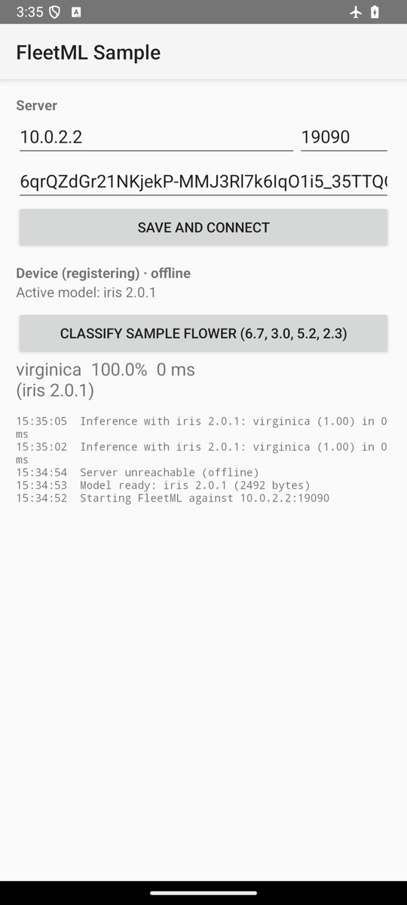
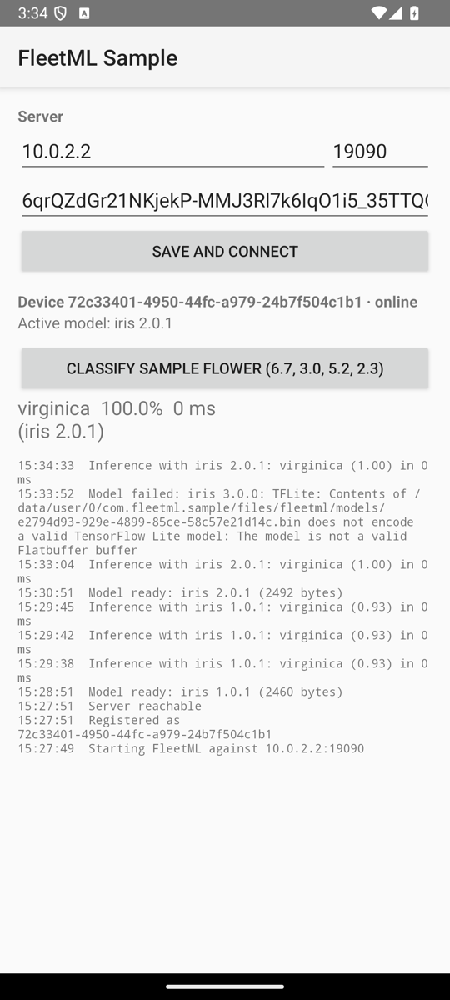
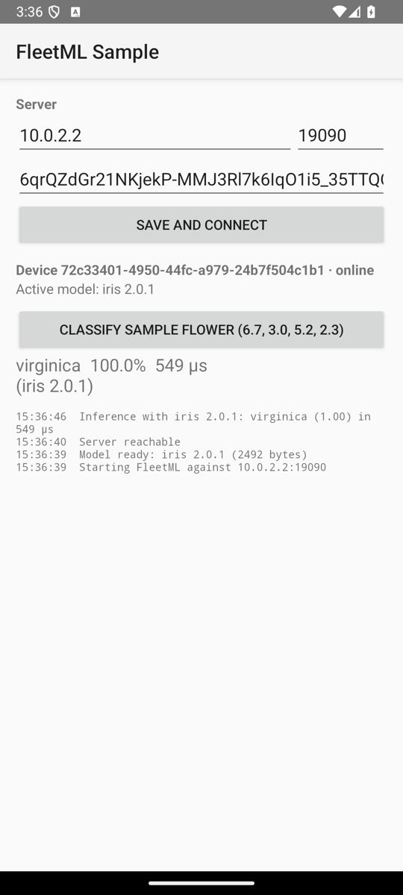

# Android SDK

The FleetML Android SDK, `dev.fleetml:fleetml-sdk` on Maven Central (Kotlin,
minSdk 26), puts a device under FleetML's control: it registers with an
enrollment key, receives model assignments over gRPC, downloads and verifies
them, validates each model before using it, keeps the last-known-good
version, works offline, and reports telemetry. It does not run your models:
your app does, with TFLite, ONNX Runtime or anything else.

This guide starts with the sample app on your phone ([Get started](#get-started)),
then follows the path to your own app and to production: add the SDK,
configure it, publish and deploy a model for it, run it on your phone, test
updates and offline behaviour, and check what production needs. The emulator,
Windows and the sample app follow as variants of the same steps.

## Get started

The [sample app](#sample-app) on your phone over a USB cable, against a
server on your Mac: copy and paste, nothing to choose. Each step says what
you should see; if you see something else, stop there and look it up in
[Troubleshooting](ADVANCED.md#troubleshooting). Use one terminal and keep it
open until the end. On Linux, see [Installing the tools](ADVANCED.md#installing-the-tools);
on Windows, [From Windows](#from-windows).

Before you start, once: [Android Studio](https://developer.android.com/studio)
(it installs the Android SDK and `adb`), [Homebrew](https://brew.sh) and Docker
Desktop; on the phone, USB debugging (Settings, About phone, tap **Build
number** seven times, then Settings, System, Developer options, **USB
debugging**). Connect the phone with its cable, accept the prompt on it, and
**keep it unlocked** while you test: a locked phone pauses the app.

1. **Check the tools.** This installs JDK 17, the one the build needs, and
   puts `adb` on the `PATH` of this terminal:

   <!-- golden: android-tools device -->
   ```bash
   brew install -q openjdk@17
   export JAVA_HOME=$(brew --prefix openjdk@17) ANDROID_HOME=$HOME/Library/Android/sdk
   export PATH="$ANDROID_HOME/platform-tools:$PATH"
   docker compose version && jq --version && "$JAVA_HOME/bin/java" -version && adb version
   ```

   You should see `openjdk version "17.` and `Android Debug Bridge version`.

2. **Start FleetML.** The first start takes a few minutes, to download and
   build the images:

   <!-- golden: start -->
   ```bash
   [ -f deploy/docker-compose.prod.yml ] || { [ -d fleetml ] || git clone https://github.com/fleetml/fleetml.git; cd fleetml; }
   [ -f ~/.fleetml.env ] || (umask 077; printf "export JWT_SECRET='%s' SIGNING_MASTER_KEY='%s' FLEETML_ADMIN_KEY='%s' FLEETML_REST_PORT=%s FLEETML_GRPC_PORT=%s FLEETML_DASHBOARD_PORT=%s FLEETML_S3_PUBLIC_PORT=%s S3_PUBLIC_ENDPOINT=localhost:%s\n" "$(openssl rand -base64 32)" "$(openssl rand -base64 32)" "$(openssl rand -hex 32)" "${FLEETML_REST_PORT:-18080}" "${FLEETML_GRPC_PORT:-19090}" "${FLEETML_DASHBOARD_PORT:-80}" "${FLEETML_S3_PUBLIC_PORT:-19100}" "${FLEETML_S3_PUBLIC_PORT:-19100}" > ~/.fleetml.env)
   source ~/.fleetml.env
   docker compose -f deploy/docker-compose.prod.yml up -d --build && for i in $(seq 90); do curl -sf localhost:${FLEETML_REST_PORT:-18080}/readyz && break; [ $i = 90 ] && echo "Not ready after 3 minutes: see Troubleshooting in docs/ADVANCED.md"; sleep 2; done || echo "Start failed: see Troubleshooting in docs/ADVANCED.md"; echo
   curl -sf -H "Authorization: Bearer $FLEETML_ADMIN_KEY" localhost:${FLEETML_REST_PORT:-18080}/api/v1/projects && echo && echo "Dashboard: http://localhost:${FLEETML_DASHBOARD_PORT:-80}  (log in with FLEETML_ADMIN_KEY from ~/.fleetml.env)"
   ```

   You should see `{"db":"connected","nats":"connected","s3":"connected","status":"ok","version":"<version>"}`.
   The block saved the server's secrets in `~/.fleetml.env`: keep that file.

3. **Get the CLI**, checked against the release's checksums:

   <!-- golden: cli -->
   ```bash
   OS=$(uname -s | tr '[:upper:]' '[:lower:]'); ARCH=$(uname -m | sed -e 's/x86_64/amd64/' -e 's/aarch64/arm64/')
   curl -fsSLO "https://github.com/fleetml/fleetml/releases/latest/download/fleetml-$OS-$ARCH.tar.gz"
   curl -fsSLO https://github.com/fleetml/fleetml/releases/latest/download/SHA256SUMS
   grep " fleetml-$OS-$ARCH.tar.gz\$" SHA256SUMS | shasum -a 256 -c
   mkdir -p ~/.local/bin && tar -xzf "fleetml-$OS-$ARCH.tar.gz" -C ~/.local/bin fleetml
   rm "fleetml-$OS-$ARCH.tar.gz" SHA256SUMS
   export PATH="$HOME/.local/bin:$PATH"
   fleetml version
   ```

   You should see `fleetml-<os>-<arch>.tar.gz: OK` and `✓ fleetml v<version>`.

4. **Publish the sample model and deploy it.** The project gets the time in
   its name, so running the block again makes a new one:

   <!-- golden: publish -->
   ```bash
   export FLEETML_SERVER=http://localhost:${FLEETML_REST_PORT:-18080} FLEETML_API_KEY=$FLEETML_ADMIN_KEY
   P=$(fleetml project create --name "first-$(date +%H%M%S)" -o json | jq -r .id)
   fleetml push models/iris/iris_v1.tflite --project $P --model iris --version 1.0.0
   V=$(fleetml ver list --model "$(fleetml model list --project $P -o json | jq -r '.[0].id')" -o json | jq -r '.[0].id')
   fleetml deploy start "$(fleetml deploy create --project $P --version $V -o json | jq -r .id)"
   export FLEETML_ENROLLMENT_KEY=$(fleetml enrollment-key create --project $P --name first-device -o json | jq -r .key)
   ```

   You should see `✓ Pushed models/iris/iris_v1.tflite → iris v1.0.0 (INT8)` and `✓ Deployment start → COMPLETE`.

5. **Put the phone on it.** Unlock the phone and keep its screen on until
   this step ends: a locked phone stops the app. This builds the sample app
   with the enrollment key from step 4 and installs it, forwards the
   server's ports to the phone (after the install, since a build can restart
   `adb`, which drops the forwards), starts the app and waits until the
   model is active on the phone (a minute or two the first time, for the
   build). It takes the first device `adb devices` lists and says which; with
   an emulator or a second phone attached, run `export ANDROID_SERIAL=<serial>`
   with the phone's serial from `adb devices` first:

   <!-- golden: android-phone device -->
   ```bash
   export ANDROID_SERIAL=${ANDROID_SERIAL:-$(adb devices | awk 'NR > 1 && $2 == "device" { print $1; exit }')}; echo "Device: $ANDROID_SERIAL, $(adb shell getprop ro.product.model)"
   (cd android && ORG_GRADLE_PROJECT_fleetmlEnrollmentKey=$FLEETML_ENROLLMENT_KEY ./gradlew -q :sample-app:installDebug -PfleetmlDebugHost=localhost -PfleetmlDebugPort=${FLEETML_GRPC_PORT:-19090} < /dev/null)
   adb reverse tcp:${FLEETML_GRPC_PORT:-19090} tcp:${FLEETML_GRPC_PORT:-19090}
   adb reverse tcp:${FLEETML_S3_PUBLIC_PORT:-19100} tcp:${FLEETML_S3_PUBLIC_PORT:-19100}
   adb logcat -c && adb shell am start -n com.fleetml.sample/.MainActivity < /dev/null
   for i in $(seq 90); do adb logcat -d -s FleetML:I | grep -m 1 'is active' && break; [ $i = 90 ] && echo "Not active after 3 minutes: see Troubleshooting"; sleep 2; done
   ```

   You should see `Device: ` with the phone's serial and model, `Installed on 1 device.`,
   the two forwarded ports, then `I FleetML : Model iris 1.0.0 is active`, and the
   app's screen **Active model: iris 1.0.0**. Tap **Classify sample flower**
   to run it. If it says `Not active after 3 minutes`, see
   [Troubleshooting](ADVANCED.md#troubleshooting): the phone locked, a
   missing forward, or the wrong device.

6. **See it in the dashboard.** This puts the admin key on the clipboard (on
   a Mac, in WSL, or on Linux with `xclip`; elsewhere it prints it) and prints
   the dashboard's address: open it and paste the key into the login box:

   <!-- golden: dashboard manual -->
   ```bash
   printf %s "$FLEETML_ADMIN_KEY" | { pbcopy || clip.exe || xclip -selection clipboard || cat; } 2> /dev/null; echo
   echo "Dashboard: http://localhost:${FLEETML_DASHBOARD_PORT:-80}"
   ```

   You should see `Dashboard: http://localhost:<port>`, and in the browser the
   Overview page (**Dashboard** in the menu); **Devices** lists one device, and **Deployments** one
   `COMPLETE` deployment of iris 1.0.0.

7. **Clean up**: the app, the forwards, the server and all its data, and
   the saved secrets:

   <!-- golden: android-cleanup device cleanup -->
   ```bash
   adb uninstall com.fleetml.sample; adb reverse --remove-all
   source ~/.fleetml.env && docker compose -f deploy/docker-compose.prod.yml down -v
   rm -f ~/.fleetml.env
   ```

   You should see `Success` and `Network <stack>_default  Removed`.

Then your own app: [Install](#install) and [Configure and start](#configure-and-start),
with the same server and key. The emulator instead of a phone:
[Emulator](#emulator). A phone over Wi-Fi:
[ADVANCED.md](ADVANCED.md#android-a-phone-over-wi-fi).

## Install

The SDK is on Maven Central; 0.10.2 is the version this guide describes (0.4.0
lacks the `passed validation` logcat line and still logs a failed heartbeat
with a stack trace). Add it to the app with TensorFlow Lite next to it:

```kotlin
// app/build.gradle.kts
dependencies {
    implementation("dev.fleetml:fleetml-sdk:0.10.2")
    implementation("org.tensorflow:tensorflow-lite:2.17.0") // if you run TFLite models
}
```

The app's repositories must include `mavenCentral()`, as a new Android Studio
project's `settings.gradle.kts` does ([a new project from the command
line](#a-new-project-from-the-command-line) lists the files without the
wizard). The SDK needs minSdk 26 and is built
with compileSdk and targetSdk 34 and Java 8 bytecode, so the app needs
compileSdk 34 or later. TensorFlow Lite is not a dependency of the SDK: the app
brings the runtime it uses, and the default validator uses it when it is there
([Validators](#validators)).

The app needs no permission of its own for the SDK: the SDK's manifest
declares `INTERNET` and `ACCESS_NETWORK_STATE`, WorkManager, which it uses for
background checks, adds `WAKE_LOCK`, `RECEIVE_BOOT_COMPLETED` and
`FOREGROUND_SERVICE`, and AndroidX Core adds the app's own
`<application ID>.DYNAMIC_RECEIVER_NOT_EXPORTED_PERMISSION` to the merged
manifest.

The SDK brings these libraries with it: `protobuf-kotlin-lite` 3.25 (as an
`api` dependency: protobuf-lite messages appear in its public API),
`grpc-okhttp` and the gRPC stubs 1.62, `okhttp` 4.12, WorkManager 2.9,
`lifecycle-process`, `security-crypto` and BouncyCastle (`bcprov-jdk18on`).
Where the app asks for a newer version of one of them, Gradle uses the newer
one; the SDK is tested with the versions above, and
`./gradlew :app:dependencies --configuration debugRuntimeClasspath` shows what
the app ends up with. An app that already uses the full `protobuf-java` gets
duplicate-class errors from Gradle, because `protobuf-javalite` and
`protobuf-java` hold the same classes; the usual fix is to exclude the lite
runtime, since the full one also contains the classes lite-generated code uses
(not tested here with every protobuf version):

```kotlin
implementation("dev.fleetml:fleetml-sdk:0.10.2") {
    exclude(group = "com.google.protobuf", module = "protobuf-javalite")
}
```

### From a clone

To work against changes that are not released yet, include the module from a
clone of this repository instead:

```kotlin
// settings.gradle.kts
include(":fleetml-sdk")
project(":fleetml-sdk").projectDir = file("path/to/fleetml/android/fleetml-sdk")

// app/build.gradle.kts
dependencies {
    implementation(project(":fleetml-sdk"))
    implementation("org.tensorflow:tensorflow-lite:2.17.0") // if you run TFLite models
}
```

The module's own build uses two more Gradle plugins and reads its version from
a property, which the app's build must then provide too: next to the app's
Android and Kotlin plugins in the root `build.gradle.kts`,

```kotlin
plugins {
    id("com.google.protobuf") version "0.9.4" apply false
    id("com.vanniktech.maven.publish") version "0.34.0" apply false
}
```

and `sdkVersion=0.10.2-dev` (any version string) in the app's
`gradle.properties`. Without them Gradle stops with
`Plugin [id: 'com.google.protobuf'] was not found`.

Building on the command line, the SDK from source or your own app from
[the skeleton below](#a-new-project-from-the-command-line), needs JDK 17: the
wrapper's Gradle 8.7 with AGP 8.5 stops at once on a newer JDK with
`What went wrong: <its version>`, for example `26.0.2.1` for Homebrew's
current `openjdk`, the `java` on a Mac's `PATH`. Point `JAVA_HOME` at a
JDK 17 in the shell you build in:
`export JAVA_HOME=/opt/homebrew/opt/openjdk@17` on macOS with Homebrew
(`brew install openjdk@17`), `/usr/lib/jvm/java-17-openjdk-amd64` on Debian
and Ubuntu (`sudo apt install openjdk-17-jdk`). Android Studio runs Gradle with the JDK
in its Gradle settings (Settings, Build, Execution, Deployment, Build Tools,
Gradle, Gradle JDK), by default its bundled JetBrains Runtime, which is Java
25 in Android Studio 2026.1: with it, Gradle 8.7 stops at once with
`What went wrong: 25.0.2`. Pick a JDK 17 there, or point `JAVA_HOME` at one
on the command line.

### A new project from the command line

Without Android Studio's wizard, these are the files of an app with the SDK,
on the versions the SDK is built and tested with: AGP 8.5.0, Kotlin 1.9.24,
Gradle 8.7 and JDK 17. The Gradle wrapper (`gradlew`, `gradlew.bat` and the
`gradle` folder) comes from any project on Gradle 8.7, such as a clone of
this repository: `cp -R <clone>/android/gradlew <clone>/android/gradlew.bat <clone>/android/gradle .`
(in PowerShell: `Copy-Item -Recurse <clone>\android\gradlew, <clone>\android\gradlew.bat, <clone>\android\gradle .`).

```kotlin
// settings.gradle.kts
pluginManagement {
    repositories { google(); mavenCentral(); gradlePluginPortal() }
}
dependencyResolutionManagement {
    repositories { google(); mavenCentral() }
}
rootProject.name = "myapp"
include(":app")
```

```kotlin
// build.gradle.kts
plugins {
    id("com.android.application") version "8.5.0" apply false
    id("org.jetbrains.kotlin.android") version "1.9.24" apply false
}
```

```kotlin
// app/build.gradle.kts
plugins {
    id("com.android.application")
    id("org.jetbrains.kotlin.android")
}

android {
    namespace = "com.example.myapp"
    compileSdk = 34
    defaultConfig {
        applicationId = "com.example.myapp"
        minSdk = 26
        targetSdk = 34
    }
    kotlinOptions { jvmTarget = "1.8" }
}

dependencies {
    implementation("dev.fleetml:fleetml-sdk:0.10.2")
    implementation("org.tensorflow:tensorflow-lite:2.17.0")
    implementation("androidx.appcompat:appcompat:1.7.0")
    implementation("androidx.lifecycle:lifecycle-runtime-ktx:2.8.7")
}
```

The manifest names the application class and a launcher activity, with an
AppCompat theme (an `AppCompatActivity` under any other theme stops at launch
with `You need to use a Theme.AppCompat theme`), and the SDK's backup rules,
which keep its encrypted registration out of backups
([Enrollment and identity](#enrollment-and-identity)):

```xml
<!-- app/src/main/AndroidManifest.xml -->
<manifest xmlns:android="http://schemas.android.com/apk/res/android">
    <application
        android:name=".MyApp"
        android:label="MyApp"
        android:theme="@style/Theme.AppCompat.DayNight.NoActionBar"
        android:fullBackupContent="@xml/fleetml_backup_rules"
        android:dataExtractionRules="@xml/fleetml_data_extraction_rules">
        <activity android:name=".MainActivity" android:exported="true">
            <intent-filter>
                <action android:name="android.intent.action.MAIN" />
                <category android:name="android.intent.category.LAUNCHER" />
            </intent-filter>
        </activity>
    </application>
</manifest>
```

and the activity shows whether the server was reached and which model is
active:

```kotlin
// app/src/main/java/com/example/myapp/MainActivity.kt
package com.example.myapp

import android.os.Bundle
import android.widget.TextView
import androidx.appcompat.app.AppCompatActivity
import androidx.lifecycle.lifecycleScope
import com.fleetml.sdk.FleetML
import kotlinx.coroutines.launch

class MainActivity : AppCompatActivity() {
    override fun onCreate(savedInstanceState: Bundle?) {
        super.onCreate(savedInstanceState)
        val status = TextView(this).also { setContentView(it) }
        lifecycleScope.launch {
            val reached = FleetML.syncNow()
            status.text = "Server reached: $reached\nModel: ${FleetML.activeModel("iris")?.version ?: "none yet"}"
        }
    }
}
```

`gradle.properties` holds `android.useAndroidX=true`, and
`local.properties` (or `ANDROID_HOME`) the Android SDK's folder,
`sdk.dir=<home>/Library/Android/sdk` on macOS, `sdk.dir=<home>/Android/Sdk`
on Linux, `sdk.dir=C\:\\Users\\<you>\\AppData\\Local\\Android\\Sdk` on Windows
(or `ANDROID_HOME` set as in [From Windows](#from-windows)). Add the `android` block of
[Configure and start](#configure-and-start) for the server's host and key,
and its `MyApp` class in `app/src/main/java/com/example/myapp/MyApp.kt`
with `package com.example.myapp` on top; for a server on your machine, the
two debug files of [On your phone](#on-your-phone). With `JAVA_HOME` at a
JDK 17 ([above](#from-a-clone)), `./gradlew :app:assembleDebug` builds it and `ORG_GRADLE_PROJECT_fleetmlEnrollmentKey=$FLEETML_ENROLLMENT_KEY ./gradlew :app:installDebug -PfleetmlDebugHost=localhost`
installs it ([Publish and deploy](#publish-and-deploy-with-the-cli) has `$FLEETML_ENROLLMENT_KEY`).
After a deployment to `app=myapp` the screen reads `Server reached: true`
and `Model: 1.0.0`.

## Configure and start

Initialize once per process, in `Application.onCreate()`, so screen rotation
never re-initializes the SDK. The configuration below is the production one:
your server's host name, port 443 and TLS, with the server behind a TLS proxy
([Production checklist](#production-checklist)). The host and the enrollment
key come from Gradle properties rather than the source, and debug builds
switch to a server on your own machine without TLS, in `app/build.gradle.kts`:

```kotlin
android {
    buildFeatures { buildConfig = true } // AGP 8 turns BuildConfig off by default
    defaultConfig {
        buildConfigField("String", "FLEETML_HOST", "\"${project.findProperty("fleetmlHost") ?: "fleet.example.com"}\"")
        buildConfigField("int", "FLEETML_PORT", "443")
        buildConfigField("boolean", "FLEETML_TLS", "true")
        buildConfigField("String", "FLEETML_ENROLLMENT_KEY", "\"${project.findProperty("fleetmlEnrollmentKey") ?: ""}\"")
    }
    buildTypes {
        debug {
            // A server on your machine: localhost for a phone over USB, 10.0.2.2 for the emulator,
            // the machine's LAN address for a phone over Wi-Fi; the port is the
            // stack's gRPC port (-PfleetmlDebugPort=${FLEETML_GRPC_PORT:-19090}).
            buildConfigField("String", "FLEETML_HOST", "\"${project.findProperty("fleetmlDebugHost") ?: "localhost"}\"")
            buildConfigField("int", "FLEETML_PORT", "${project.findProperty("fleetmlDebugPort") ?: "19090"}")
            buildConfigField("boolean", "FLEETML_TLS", "false")
        }
    }
}
```

Without `buildFeatures { buildConfig = true }`, an AGP 8 project stops with
`Unresolved reference: BuildConfig`. The build gets the values as Gradle
properties: the enrollment key from the environment,
`ORG_GRADLE_PROJECT_fleetmlEnrollmentKey=$FLEETML_ENROLLMENT_KEY ./gradlew :app:installDebug`
(Gradle reads `ORG_GRADLE_PROJECT_<name>` as the property `<name>`, and the
key stays off the command line, where `-PfleetmlEnrollmentKey=` would show it
to anyone who lists processes), the host as `-PfleetmlDebugHost=...`, or both
from `~/.gradle/gradle.properties`, outside the project
(`fleetmlEnrollmentKey=...`, `fleetmlHost=...`). The enrollment key comes from
`fleetml enrollment-key create --project <project ID>`, which prints it once
([Publish and deploy](#publish-and-deploy-with-the-cli)). The SDK's classes are
in the package `com.fleetml.sdk`; the Maven group, `dev.fleetml`, is a
different name, so `import dev.fleetml...` finds nothing:

```kotlin
import android.app.Application
import com.fleetml.sdk.*

class MyApp : Application(), FleetMLCallback {
    override fun onCreate() {
        super.onCreate()
        FleetML.init(
            context = this,
            config = FleetMLConfig(
                serverHost = BuildConfig.FLEETML_HOST,
                serverPort = BuildConfig.FLEETML_PORT,
                useTls = BuildConfig.FLEETML_TLS,
                enrollmentKey = BuildConfig.FLEETML_ENROLLMENT_KEY,
                labels = mapOf("app" to "myapp", "tier" to "beta"),
            ),
            callback = this,
        )
    }

    override fun onModelReady(model: ActiveModel) {
        // model.file is verified and validated: load it.
    }
}
```

Register the class in `AndroidManifest.xml` with
`<application android:name=".MyApp" ...>`. For a quick test only,
`enrollmentKey = "<enrollment key>"` works too, but the key then sits in a file
you commit. After [Publish and deploy](#publish-and-deploy-with-the-cli),
the debug values are what [On your phone](#on-your-phone) uses, with
`localhost` over USB or the LAN address over Wi-Fi, and the
[Emulator](#emulator) with `10.0.2.2`.

`FleetMLCallback` has five methods, each with an empty default, so implement
only what the app needs. They run on a background thread: switch to the main
thread before touching views.

| Callback | When |
|---|---|
| `onModelReady(model: ActiveModel)` | A model was downloaded, verified and validated and is now active; also at start for models cached from an earlier run |
| `onModelUnload(modelId: String, modelName: String, variantId: String)` | The server no longer assigns the model |
| `onModelLoadFailed(modelName: String, version: String, reason: String)` | A new version could not be downloaded or failed validation; the last-known-good one stays |
| `onRegistered(deviceId: String)` | The device registered (or re-registered) |
| `onConnectionStatusChanged(connected: Boolean)` | The server became reachable or unreachable |

`onModelReady` hands over an `ActiveModel`:

| `ActiveModel` field | Type | What it is |
|---|---|---|
| `modelName` | `String` | The model's name, for example `iris` |
| `version` | `String` | The version, for example `1.0.0` |
| `file` | `java.io.File` | The model file on disk, sha256-verified and validated: load this |
| `modelId` | `String` | The model's ID, the same for every version |
| `versionId` | `String` | The version's ID; telemetry is attributed to it |
| `variantId` | `String` | The variant (one file of the version) the server chose for this device |
| `sha256` | `String` | The file's sha256 |

The other calls on `FleetML`:

| Call | What it does |
|---|---|
| `fun activeModel(modelName: String): ActiveModel?` | The active version of one model, or `null` before it has one |
| `fun activeModels(): List<ActiveModel>` | Every active model |
| `suspend fun syncNow(): Boolean` | One heartbeat and one telemetry flush now; `true` if the server was reached |
| `fun getTelemetryReporter(): TelemetryReporter` | Reports inferences ([Telemetry](#telemetry)) |
| `fun deviceId(): String?`, `fun isRegistered(): Boolean` | The device's ID once registered |
| `fun stop()` | Stops background work and clears the singleton, so `init` can be called again (for example with a new server address) |
| `fun reset(context: Context? = null)` | Also deletes cached models and the registration; with a `context`, before `init` |

`syncNow()` is a `suspend` function, so call it from a coroutine, for example
from an AndroidX activity (`AppCompatActivity` or `ComponentActivity`; a
plain `android.app.Activity` has no `lifecycleScope`) with
`androidx.lifecycle:lifecycle-runtime-ktx:2.8.7` in the app's dependencies
and `import androidx.lifecycle.lifecycleScope` and
`import kotlinx.coroutines.launch` in the file:

```kotlin
lifecycleScope.launch { val reached = FleetML.syncNow() }
```

Called while a heartbeat is in flight, at start-up for example, it joins that
heartbeat rather than sending a second one, so a model is downloaded and
`onModelReady` fires once.

| `FleetMLConfig` field | Default | Purpose |
|---|---|---|
| `serverHost`, `serverPort` | –, `19090` | The FleetML gRPC endpoint |
| `enrollmentKey` | `""` | Per-project key for the first registration (`fleetml enrollment-key create`) |
| `useTls` | `false` | TLS for gRPC (`true` with the server behind a TLS proxy, as in production) |
| `labels` | `{}` | Labels deployments and experiments target (`target_selector`) |
| `heartbeatIntervalSeconds` | `30` | Foreground heartbeat interval, until the server sends its own (server default 60) |
| `backgroundHeartbeatIntervalSeconds` | `3600` | Background check interval, until the server sends its own (at least 15 minutes) |
| `telemetryBatchSize`, `telemetryFlushIntervalSeconds` | `50`, `30` | Until the server's `DeviceConfig` overrides them (server default 100; the SDK uses 50 until the first response) |
| `maxCacheSizeMb` | `500` | Disk budget for models; the active and last-known-good models are never evicted |
| `downloadPolicy` | `UNMETERED_OR_CHARGING` | Which networks non-urgent downloads may use, until the server sends its own ([Battery and data](#battery-and-data)) |
| `autoStart` | `true` | Call `FleetML.start()` yourself if `false` |

## Publish and deploy with the CLI

The CLI side: a project, two versions, an enrollment key, and a deployment to
the labels the app sets (`app=myapp` above). It needs the `fleetml` CLI
([Get the CLI](QUICKSTART.md#get-the-cli)) and `jq`, and a key for the server:

- **The server's admin key** (the quickstart's `$FLEETML_ADMIN_KEY`) does
  everything below, including creating the project.
- **A key for a user with the `admin` role in an existing project** does
  everything but create the project (`Error: this needs a global admin`);
  with `operator` it publishes and deploys, and `enrollment-key create` stops
  with `Error: this needs the admin role in this project`
  ([roles](ARCHITECTURE.md#users-roles-and-the-audit-log)).
- **Only the enrollment key**, when whoever runs the server creates the
  deployment: the app needs nothing else.

The two models are the sample's, from the root of a clone; push your own
`.tflite` files instead. With the quickstart's server, `FLEETML_SERVER` is
`http://localhost:${FLEETML_REST_PORT:-18080}` and the key `$FLEETML_ADMIN_KEY` after
`source ~/.fleetml.env`:

```bash
export FLEETML_SERVER=<server URL> FLEETML_API_KEY=<the admin or project key your team gave you>
P=$(fleetml project create --name myapp -o json | jq -r .id)   # or P=<the project ID your team gave you>
fleetml push models/iris/iris_v1.tflite --project $P --model iris --version 1.0.0
fleetml push models/iris/iris_v2.tflite --project $P --model iris --version 2.0.0
M=$(fleetml model list --project $P -o json | jq -r '.[] | select(.name == "iris") | .id')
V1=$(fleetml ver list --model $M -o json | jq -r '.[] | select(.version == "1.0.0") | .id')
V2=$(fleetml ver list --model $M -o json | jq -r '.[] | select(.version == "2.0.0") | .id')
export FLEETML_ENROLLMENT_KEY=$(fleetml enrollment-key create --project $P --name myapp -o json | jq -r .key)
D1=$(fleetml deploy create --project $P --version $V1 --target '{"app":"myapp"}' -o json | jq -r .id)
fleetml deploy start $D1
```

Each push prints `✓ Pushed ...`. The enrollment key is in `$FLEETML_ENROLLMENT_KEY`
(`-o json | jq -r .key` takes the key; the plain command prints it once for
copying); build the app with it from the same shell, as in [On your
phone](#on-your-phone). The deployment starts as `COMPLETE`
(`✓ Deployment start → COMPLETE`), which means assigned; once the app runs,
logcat shows `Model iris 1.0.0 is active`. `fleetml deploy get $D1 | jq -c .devices`
counts what the devices reported in their last heartbeat, so it prints
`{"loaded":0,"targeted":0}` until the app has registered,
`{"loaded":0,"targeted":1}` until its next heartbeat (60 seconds by
default) and `{"loaded":1,"targeted":1}` after it; it is counted each time you
ask, so once 2.0.0 replaces it, this deployment counts down to
`{"loaded":0,"targeted":1}`.

When you are done, on a server you keep, `fleetml project delete $P`
removes the project with its devices, deployments and telemetry, so the
phone's test leaves nothing behind (it asks for no confirmation and cannot
be undone); the quickstart's [Clean up](QUICKSTART.md#clean-up) removes the
whole stack instead.

## On your phone

**Keep the phone unlocked, with the app in front, while you test** (in the
developer options, Stay awake keeps the screen on while it charges). The
SDK's timers run only while the app is in the foreground: a locked or
sleeping phone puts the app in the background, so heartbeats, retries,
updates and reconnects wait until you open it again, and recent Android
versions freeze the process outright.

A phone reaches a server on your machine over USB, as `localhost` through
`adb` port forwards, or over Wi-Fi at the machine's LAN address. Both talk
plain HTTP to it (gRPC, and model downloads on the object store's port), which Android
blocks by default, so debug builds get a network security config that allows
it to those addresses only; release builds keep Android's default
([Production checklist](#production-checklist)). The server is the one from the
[quickstart](QUICKSTART.md#run-fleetml) or any FleetML server without TLS that
the phone can reach. None of this section is verified on a phone by CI; the
maintainers run it by hand.

```xml
<!-- app/src/debug/res/xml/network_security_config.xml -->
<network-security-config>
    <domain-config cleartextTrafficPermitted="true">
        <domain includeSubdomains="false">localhost</domain>
        <domain includeSubdomains="false">10.0.2.2</domain>
        <!-- over Wi-Fi: the LAN address of the machine that runs the server -->
        <!-- <domain includeSubdomains="false"><LAN IP></domain> -->
    </domain-config>
</network-security-config>
```

```xml
<!-- app/src/debug/AndroidManifest.xml -->
<manifest xmlns:android="http://schemas.android.com/apk/res/android">
    <application android:networkSecurityConfig="@xml/network_security_config" />
</manifest>
```

### Over USB

1. Turn on USB debugging in the phone's developer options, connect it and
   accept the authorisation prompt; `adb devices` then lists it as `device`.
   On macOS and Linux, `adb` and `emulator` are in the Android SDK, not on the
   `PATH`: `export PATH="$HOME/Library/Android/sdk/platform-tools:$HOME/Library/Android/sdk/emulator:$PATH"`
   (`$HOME/Android/Sdk/...` on Linux).
   On Windows, `adb devices` lists a phone only with its maker's USB driver
   (Google's for Pixel phones, from the SDK Manager), see
   [From Windows](#from-windows).
2. Pin `adb` and Gradle to the phone in this shell, with its serial from
   `adb devices`. With more than one device attached, an emulator or a
   colleague's phone, Gradle otherwise installs on every one of them and `adb`
   asks which one to use:

   ```bash
   export ANDROID_SERIAL=<the phone's serial>
   ```

3. Forward the REST, gRPC and model-file ports, so the phone reaches the
   machine as `localhost` (again after each reconnect of the cable, and
   after a build that restarted `adb`: `adb reverse --list` shows what is
   forwarded):

   ```bash
   . ~/.fleetml.env
   adb reverse tcp:${FLEETML_REST_PORT:-18080} tcp:${FLEETML_REST_PORT:-18080}
   adb reverse tcp:${FLEETML_GRPC_PORT:-19090} tcp:${FLEETML_GRPC_PORT:-19090}
   adb reverse tcp:${FLEETML_S3_PUBLIC_PORT:-19100} tcp:${FLEETML_S3_PUBLIC_PORT:-19100}
   ```

   The model files' port matters as much as the gRPC port: the server hands
   out model downloads as presigned URLs for its `S3_PUBLIC_ENDPOINT`,
   `localhost` on that port in the quickstart, so without that forward the
   phone registers and then fails every download
   ([CONFIG.md](CONFIG.md#network-and-storage)). The lines read the saved
   ports, so a stack started with other ports needs no change. On the dev
   stack (`make dev`), forward 19000, its object store, instead of the
   model files' port. If the server's
   `S3_PUBLIC_ENDPOINT` is your LAN address (after [Over Wi-Fi](#over-wi-fi)),
   downloads go there instead, also over USB: the phone must be on that
   network and the debug network security config must allow the address, or
   every download fails with `CLEARTEXT communication to <LAN IP> not permitted`;
   or put it [back to `localhost`](ADVANCED.md#a-phone-or-another-machine-the-download-address)
   (the block there). This shows the value in use:

   ```bash
   docker inspect $(docker compose -f deploy/docker-compose.prod.yml ps -q server) --format '{{range .Config.Env}}{{println .}}{{end}}' | grep S3_PUBLIC_ENDPOINT
   ```

4. Build and install the debug build, whose host is `localhost`, with the
   enrollment key from [Publish and deploy](#publish-and-deploy-with-the-cli)
   (`$FLEETML_ENROLLMENT_KEY`), and start the app:

   ```bash
   ORG_GRADLE_PROJECT_fleetmlEnrollmentKey=$FLEETML_ENROLLMENT_KEY ./gradlew :app:installDebug -PfleetmlDebugPort=${FLEETML_GRPC_PORT:-19090}
   adb shell monkey -p <application ID> -c android.intent.category.LAUNCHER 1
   ```

The SDK logs every step to logcat with the tag `FleetML`
(`adb logcat -s FleetML`). Within seconds of `FleetML.init`,
`onRegistered(deviceId)` fires and the device appears in
`fleetml device list --project $P` and on the dashboard's Devices page. If a
deployment already targets the app's labels, the model arrives right after
registration and `onModelReady` fires; a deployment created later arrives
with the next heartbeat, 60 seconds with the server's default. A first run
that registers and receives iris 1.0.0 prints (time stamps and process IDs
left out):

```text
D FleetML : Registering device with fingerprint <first 12 hex digits>...
D FleetML : Registration saved for device <device ID>
I FleetML : Registered as device <device ID>
I FleetML : Downloaded model <variant ID> (2KB)
I FleetML : Model iris 1.0.0 passed validation
I FleetML : Model iris 1.0.0 is active
```

Each line comes once, also when the app calls `FleetML.syncNow()` in
`onCreate`. When the app goes to the background (another app in front, or
the phone locked), the SDK schedules its background check and logs
`In the background: next sync in 3600s through WorkManager`; it cancels the
check when the app is in front again.

At warning level or above it logs why registration, a heartbeat or a
download failed, one line each, such as an unreachable host or a refused
enrollment key; the stack trace of each failure follows at debug level, which
`adb logcat FleetML:I *:S` leaves out (`FleetML:D` shows them, with the
debug-level lines such as `Telemetry flushed`). A missing forward of the model files' port shows as
`Download of <variant ID> interrupted at 0 bytes: Failed to connect to localhost/127.0.0.1:<model files port>`
on every heartbeat.

After fixing something (a port forward, a key, a deployment), the app does
not have to wait for its next heartbeat: `FleetML.syncNow()` runs one now, and
force-stopping and reopening the app (`adb shell am force-stop <application ID>`,
then start it again) registers and heartbeats straight away. The SDK's timers
run only while the app is in the foreground: an app behind another one waits
for its hourly background check ([Battery and data](#battery-and-data)), so
bring it to the front after a fix.

### Over Wi-Fi

Moved to [ADVANCED.md](ADVANCED.md#android-a-phone-over-wi-fi): the
machine's LAN address as the server's download address, the firewall, and
the debug build with that address.

## Offline and update tests

These tests assume the app in front on an unlocked phone ([On your
phone](#on-your-phone)): the timings below are for an app in the
foreground, and a locked phone waits until it is opened again.

**An update.** Roll out 2.0.0:

```bash
D2=$(fleetml deploy create --project $P --version $V2 --target '{"app":"myapp"}' -o json | jq -r .id)
fleetml deploy start $D2
```

The app gets it with its next heartbeat, 60 seconds by default; logcat shows
`Model iris 2.0.0 built from a 603-byte delta instead of 2492 bytes` and
`Model iris 2.0.0 is active`, and 1.0.0 stays on the device as
last-known-good. After that, `fleetml telemetry events --model-version $V2`
prints a table of the version's events (type, latency, confidence, error): a
`MODEL_LOAD` when the version became active, and an `INFERENCE` for each
[inference the app reports](#telemetry). Before the app has the version it
prints `No results.`.

**Offline.** Models activated in an earlier run are delivered through
`onModelReady` (and `FleetML.activeModels()`) as soon as the SDK starts,
before the server is reached; until the server answers, the app keeps using
them and `onConnectionStatusChanged` reports reachability. On a phone over
Wi-Fi, turn on airplane mode, then force-stop and reopen the app. On a phone
over USB, airplane mode does not cut the `adb reverse` forwards, so remove them
instead:

```bash
adb reverse --remove-all
adb shell am force-stop <application ID>
adb shell monkey -p <application ID> -c android.intent.category.LAUNCHER 1
```

`onModelReady` fires for the cached model at once and
`onConnectionStatusChanged(false)` follows. Logcat shows each failed heartbeat
on one line, over USB without the forwards:

```text
W FleetML : Heartbeat failed: UNAVAILABLE: connect failed: ECONNREFUSED (Connection refused)
```

and in airplane mode:

```text
W FleetML : Heartbeat failed: UNAVAILABLE: connect failed: ENETUNREACH (Network is unreachable)
```

With events waiting to be sent (an inference reported while offline, say),
each flush adds
`W FleetML : Telemetry flush failed, 1 events kept: UNAVAILABLE: ...`; with
an empty queue there is no such line. Set the three forwards again (or turn
airplane mode off): a later heartbeat reconnects, `onConnectionStatusChanged(true)`
fires and what is queued is sent (`Telemetry flushed: 1 sent, 1 accepted`, at
debug level: with `adb logcat FleetML:I *:S` the reconnect itself shows as
the next line that is not a failure, such as a download).
The SDK retries every 30 seconds until the server answers, and after airplane
mode the network itself takes a moment to come back, so expect the reconnect
within about a minute: it took 28 seconds after the forwards were set again,
and 24 to 50 seconds after airplane mode was turned off, on an API 35
emulator.

**On the emulator** the same test runs with airplane mode, which also cuts
`10.0.2.2`, on API 30 and later (on API 26 to 29, the quick settings tile):

```bash
adb shell cmd connectivity airplane-mode enable
adb shell am force-stop <application ID>
adb shell monkey -p <application ID> -c android.intent.category.LAUNCHER 1
```

and `adb shell cmd connectivity airplane-mode disable` brings the network
back.



## Production checklist

- **TLS.** FleetML does not terminate TLS: put a proxy in front that does,
  for gRPC (the gRPC port; gRPC needs HTTP/2 end to end) and for the object
  store's downloads (the model files' port, or your S3 endpoint), see the
  [trust boundaries](ARCHITECTURE.md#trust-boundaries) and, on Kubernetes, the
  [Helm chart](../deploy/helm/fleetml/README.md). The app then uses
  `serverPort = 443` and `useTls = true`, the release values in
  [Configure and start](#configure-and-start).
- **The download address.** The server's `S3_PUBLIC_ENDPOINT` must be an
  address phones reach from the public internet, since every download URL is
  signed for it ([CONFIG.md](CONFIG.md#network-and-storage)); with an object
  store behind the same proxy, its public host name on 443.
- **Backups.** Point the app at the SDK's backup rules, as the
  [skeleton's manifest](#a-new-project-from-the-command-line) does, or add
  the SDK's exclude line to the app's own rules
  ([Enrollment and identity](#enrollment-and-identity)): a restored copy of
  the encrypted registration cannot be read on the new phone, which makes
  the SDK register again.
- **Release builds** carry no network security config: the cleartext config
  lives in `src/debug` only, so a release build keeps Android's default and
  talks TLS only.
- **The enrollment key** is not a secret in the way a password is (it is in
  every installed APK), but it lets a device join the project: keep it out of
  the source (a Gradle property or the CI's secret store), give each app or
  release channel its own (`fleetml enrollment-key create --name ...`), and
  revoke one that leaks: devices that already registered keep their device
  tokens, and only new registrations need the new key.
- **Foreground only.** The SDK's heartbeat and telemetry timers run only
  while the app is in the foreground. In the background a WorkManager job
  checks in every `background_heartbeat_interval_seconds` (an hour by
  default, at least 15 minutes), which survives reboots, though some makers'
  battery optimisations delay or skip background jobs for apps the user has
  not opened in a while; this is not tested per maker here. A locked phone
  counts as the background, and recent Android versions freeze the process,
  so expect the fleet's state (last seen, loaded versions, telemetry) to lag
  for users who seldom open the app.

## Emulator

The emulator reaches the machine it runs on as `10.0.2.2`, so the debug build
gets that host: `-PfleetmlDebugHost=10.0.2.2`. That covers gRPC.
Model files are another matter: the server hands each one out as a URL for
`localhost` on the model files' port (the quickstart's `S3_PUBLIC_ENDPOINT`), and `localhost`
inside the emulator is the emulator itself. Forward that one port once per
emulator start, before the app's first download, with `ANDROID_SERIAL` set to
the emulator (the name `adb devices` lists) when a phone is attached too:

```bash
export ANDROID_SERIAL=emulator-5554
adb reverse tcp:${FLEETML_S3_PUBLIC_PORT:-19100} tcp:${FLEETML_S3_PUBLIC_PORT:-19100}
ORG_GRADLE_PROJECT_fleetmlEnrollmentKey=$FLEETML_ENROLLMENT_KEY ./gradlew :app:installDebug -PfleetmlDebugHost=10.0.2.2
adb shell monkey -p <application ID> -c android.intent.category.LAUNCHER 1
```

Without the forward the app registers and then logs
`Download of <variant ID> interrupted at 0 bytes: Failed to connect to localhost/127.0.0.1:<model files port>`
on every heartbeat. With the server's `S3_PUBLIC_ENDPOINT` on your LAN address
([Over Wi-Fi](#over-wi-fi)), downloads go there instead, and the emulator's
debug network security config must allow that address too
(`CLEARTEXT communication to <LAN IP> not permitted` otherwise). With all three forwards from [Over USB](#over-usb), the
emulator runs the phone's USB path as it is, with the default `localhost`.
`adb shell pm clear <application ID>` starts the app from nothing: no
registration, no cached model. Airplane mode is in [Offline and update
tests](#offline-and-update-tests).

### Emulator runbook

This is how the SDK and the [sample app](#sample-app) are verified, against
the server from the [quickstart](QUICKSTART.md#run-fleetml) (the production
compose stack, with the admin key in `$FLEETML_ADMIN_KEY`) and the `fleetml`
CLI. It runs from the root of a clone, since the sample app and models are in
the repository. Contributors on the dev stack (`make dev`) use the key from
`.env` and the dev stack's object store port, 19000, instead of the model
files' port.

1. Start the server with the quickstart's "Run FleetML" block (or
   `source ~/.fleetml.env` in a new shell).

2. Start an emulator (API 26 or later), from Android Studio's Device Manager
   or `emulator -avd <name>`, pin to it and forward the object store's port:

   ```bash
   export ANDROID_SERIAL=emulator-5554
   adb reverse tcp:${FLEETML_S3_PUBLIC_PORT:-19100} tcp:${FLEETML_S3_PUBLIC_PORT:-19100}
   ```

   The sample app connects to `10.0.2.2` on the gRPC port by default.

3. Publish the sample models, create an enrollment key and deploy 1.0.0 to the
   sample app's label (`app=sample`), as in [Publish and
   deploy](#publish-and-deploy-with-the-cli) with these names:

   ```bash
   export FLEETML_SERVER=http://localhost:${FLEETML_REST_PORT:-18080} FLEETML_API_KEY=$FLEETML_ADMIN_KEY
   P=$(fleetml project create --name android-demo -o json | jq -r .id)
   fleetml push models/iris/iris_v1.tflite --project $P --model iris --version 1.0.0
   fleetml push models/iris/iris_v2.tflite --project $P --model iris --version 2.0.0
   M=$(fleetml model list --project $P -o json | jq -r '.[] | select(.name == "iris") | .id')
   V1=$(fleetml ver list --model $M -o json | jq -r '.[] | select(.version == "1.0.0") | .id')
   V2=$(fleetml ver list --model $M -o json | jq -r '.[] | select(.version == "2.0.0") | .id')
   export FLEETML_ENROLLMENT_KEY=$(fleetml enrollment-key create --project $P --name emulator -o json | jq -r .key)
   D=$(fleetml deploy create --project $P --version $V1 --target '{"app":"sample"}' -o json | jq -r .id)
   fleetml deploy start $D
   ```

4. Build and install the sample app with the key (it connects by itself on
   its first start; or type the settings on its config screen and tap
   **Save and connect**), and open it. A fresh clone has no
   `android/local.properties`, so Gradle on the command line finds the Android
   SDK through `ANDROID_HOME` (`$HOME/Library/Android/sdk` on macOS,
   `$HOME/Android/Sdk` on Linux, where Android Studio puts it), and it needs JDK
   17 ([From a clone](#from-a-clone)); Android Studio writes `local.properties`
   when it opens the project.

   ```bash
   export ANDROID_HOME=$HOME/Library/Android/sdk JAVA_HOME=/opt/homebrew/opt/openjdk@17
   cd android
   ORG_GRADLE_PROJECT_fleetmlEnrollmentKey=$FLEETML_ENROLLMENT_KEY ./gradlew :sample-app:installDebug -PfleetmlDebugPort=${FLEETML_GRPC_PORT:-19090}
   adb shell am start -n com.fleetml.sample/.MainActivity
   ```

   A build with a key it has not used before connects with that key, also
   where the sample app ran before; a reinstall of the same build keeps
   what its config screen saved, and `adb shell pm clear com.fleetml.sample`
   starts it from nothing (the device's token goes too, so a key of another
   project is then refused: see `this device is already registered` below).

   The app registers, downloads iris 1.0.0, validates it and shows
   **Active model: iris 1.0.0**; logcat shows the lines in [Over
   USB](#over-usb). **Classify sample flower** runs it and reports inference
   telemetry. `fleetml deploy create --project $P --version $V2 --target '{"app":"sample"}'`
   and `deploy start` update the app to 2.0.0 on its next heartbeat.

5. Offline start: airplane mode as in [Offline and update
   tests](#offline-and-update-tests), force-stop and reopen the app. The
   cached model is active immediately and inference works; events are queued
   and sent once airplane mode is off.

The sample app runs on a phone the same way: over USB, the three forwards and
`-PfleetmlDebugHost=localhost` on the Gradle line (the config screen then
shows `localhost` in place of `10.0.2.2`); over Wi-Fi,
`-PfleetmlDebugHost=<LAN IP>` ([Over Wi-Fi](#over-wi-fi)). With
`S3_PUBLIC_ENDPOINT` on the LAN address, its downloads go there on the
emulator and over USB too, so build those with `-PfleetmlDebugHost=<LAN IP>`
as well and type the host on the screen. A build with another host, port
or enrollment key replaces the settings the app saved, and the SDK
registers again with it (with the device's token, so the server moves the
device to the new key's project); a revoked key shows in logcat as
`Registration failed: UNAUTHENTICATED: unauthenticated: invalid or revoked enrollment key`.

**`this device is already registered`** in logcat
(`Registration failed: UNAUTHENTICATED: ... this device is already registered; re-register with its current device token or an enrollment key for its project`):
the phone or emulator was registered in another project before and the app
lost its device token since (an uninstall, `adb shell pm clear`), so it
comes back with only a key of another project, which the server refuses: a
key alone must not take a known device over. Remove the old device record
with the admin key, then start the app again. Its ID is in
`fleetml device list` (without `--project` it lists the devices of every
project: the row with your phone's Chipset, a device has one record; the
dashboard's Devices page shows it too):

```bash
curl -fsS -X DELETE -H "Authorization: Bearer $FLEETML_ADMIN_KEY" "localhost:${FLEETML_REST_PORT:-18080}/api/v1/devices/<device ID>" && echo removed
adb shell am start -S -n com.fleetml.sample/.MainActivity
```

You should see `removed`, and in logcat `Registered as device` with a new
ID. Building with the old project's key instead also works.

## From Windows

The server runs in WSL 2 ([On Windows](QUICKSTART.md#on-windows)); the
Android tools, Gradle and a second clone of the repository run on the Windows
side, in PowerShell, where Android Studio installs the tools (`adb` and the
emulator in `%LOCALAPPDATA%\Android\Sdk`; an `adb` inside Ubuntu sees
neither a phone nor the Windows emulator, and Gradle is slow on a
`\\wsl.localhost` path). This is the sample app on a phone over USB from
start to end, then over Wi-Fi, then on the emulator; your own app is the same
with `:app:installDebug` in its project. CI builds the sample app with
`gradlew.bat` on `windows-latest`; the phone steps are run by hand. This is
for x64 Windows: on Windows on Arm the Gradle build is untested (there is no
`windows-aarch_64` build of the protobuf compiler it fetches), as the
quickstart says of Docker there.

Once, before you start:

- **Android Studio**, for the SDK and `adb`.
- **JDK 17**, for Gradle 8.7: `winget install --id EclipseAdoptium.Temurin.17.JDK -e`
  (a per-machine install: Windows asks for an administrator).
  Android Studio's bundled JDK (the JetBrains Runtime in its `jbr` folder) is
  Java 25 in Android Studio 2026.1, and Gradle 8.7 does not run on it:
  `gradlew.bat` stops at once with `What went wrong: 25.0.2`. CI builds the
  sample app with Temurin 17, the same JDK.
- **Git for Windows**: `winget install --id Git.Git -e`, or Android Studio's
  File, New, Project from Version Control. After a winget install, open a
  new PowerShell window, so that `git` (and the JDK above) are on its
  `PATH`.
- **The `fleetml` CLI for Windows**, from [Get the CLI](QUICKSTART.md#get-the-cli).
- **The phone**: developer options with USB debugging on, and its maker's USB
  driver on Windows (Google's for Pixel phones, from the SDK Manager) so that
  `adb devices` lists it. Keep it unlocked with the app in front while you
  test (developer options, Stay awake while charging): a locked phone stops
  the SDK ([Battery and data](#battery-and-data)).

In PowerShell, a clone, then the publish and deploy steps of [Publish and
deploy](#publish-and-deploy-with-the-cli) with `ConvertFrom-Json` in place of
`jq`, so the enrollment key stays in this window. The admin key comes from
the stack's `~/.fleetml.env` in Ubuntu, and `deploy create` without
`--target` targets every device in the project, so no JSON has to be quoted:

```powershell
git clone https://github.com/fleetml/fleetml.git $HOME\fleetml
cd $HOME\fleetml
$env:FLEETML_SERVER = wsl -d Ubuntu --exec bash -c '. ~/.fleetml.env && printf http://localhost:%s ${FLEETML_REST_PORT:-18080}'
$env:FLEETML_API_KEY = wsl -d Ubuntu --exec bash -c '. ~/.fleetml.env && printf %s $FLEETML_ADMIN_KEY'
$P = (fleetml project create --name "android-windows-$(Get-Date -Format yyyyMMdd-HHmmss)" -o json | ConvertFrom-Json).id
fleetml push models\iris\iris_v1.tflite --project $P --model iris --version 1.0.0
$M = (fleetml model list --project $P -o json | ConvertFrom-Json)[0].id
$V1 = (fleetml ver list --model $M -o json | ConvertFrom-Json)[0].id
$EK = (fleetml enrollment-key create --project $P --name phone -o json | ConvertFrom-Json).key
$D1 = (fleetml deploy create --project $P --version $V1 -o json | ConvertFrom-Json).id
fleetml deploy start $D1
```

The push prints `✓ Pushed models\iris\iris_v1.tflite → iris v1.0.0 (INT8)`
and the last line `✓ Deployment start → COMPLETE`. Then the phone, with its
serial from `adb devices`, the three port forwards that make the machine
`localhost` for the phone, and the sample app built with that host and the
key:

```powershell
$env:ANDROID_HOME = "$env:LOCALAPPDATA\Android\Sdk"
$env:JAVA_HOME = (Get-ChildItem "$env:ProgramFiles\Eclipse Adoptium" -Directory -Filter 'jdk-17*')[0].FullName
& "$env:JAVA_HOME\bin\java" -version
$env:Path += ";$env:ANDROID_HOME\platform-tools"
adb devices
$env:ANDROID_SERIAL = '<the phone''s serial>'
$rest, $grpc, $s3 = (wsl -d Ubuntu --exec bash -c '. ~/.fleetml.env && echo ${FLEETML_REST_PORT:-18080} ${FLEETML_GRPC_PORT:-19090} ${FLEETML_S3_PUBLIC_PORT:-19100}').Split(' ')
adb reverse tcp:$rest tcp:$rest
adb reverse tcp:$grpc tcp:$grpc
adb reverse tcp:$s3 tcp:$s3
cd android
$env:ORG_GRADLE_PROJECT_fleetmlEnrollmentKey = $EK
.\gradlew.bat :sample-app:installDebug "-PfleetmlDebugHost=localhost" "-PfleetmlDebugPort=$grpc"
adb shell monkey -p com.fleetml.sample -c android.intent.category.LAUNCHER 1
adb logcat -s FleetML
```

The project name carries the time, since names are unique on a server: a
second run of the block makes a new project instead of stopping with
`project already exists` and an empty `$P`. `java -version` prints
`openjdk version "17.0...` (Temurin). The `-P`
arguments are in quotes because PowerShell splits an unquoted
`-Pname=192.168.1.23` at the first dot and Gradle then sees `-Pname=192`,
and does not expand a `$variable` in an unquoted `-P` argument either. The
enrollment key goes to Gradle as `$env:ORG_GRADLE_PROJECT_fleetmlEnrollmentKey`,
which Gradle reads as the property and which keeps it off the build's
command line, where Task Manager and `Get-CimInstance Win32_Process` show
it to every process of the user. The `$rest, $grpc, $s3` line reads the
stack's three ports from the Ubuntu shell's `~/.fleetml.env`, so a port
moved out of a reserved range ([Troubleshooting](ADVANCED.md#troubleshooting),
[Other ports](ADVANCED.md#other-ports)) needs no change here, in the
firewall rule below or on the emulator. The reverses reach the ports Docker
Desktop publishes on Windows. The app connects by itself on its first
start (a build with a key does), with host `localhost`, the gRPC port and
the key on its config screen. (Without `-PfleetmlDebugHost` the screen shows `10.0.2.2`,
which is the emulator's address for the machine and does not work on a
phone.) Logcat then shows the lines of [Over USB](#over-usb), among them
`Registered as device <device ID>`, `Model iris 1.0.0 passed validation`
and `Model iris 1.0.0 is active`, and the app's screen **Active model: iris 1.0.0** (its log line reads `Model ready: iris 1.0.0`).
`adb logcat` runs until Ctrl+C: stop it (or open a second window) before
the next steps.
A rebuild with another key connects with it, also on a phone where the
sample app ran before; a reinstall of the same build keeps what its config
screen saved. `adb shell pm clear com.fleetml.sample` resets the app (it
deletes the app's data). A stale key shows as
`Registration failed: UNAUTHENTICATED: unauthenticated: invalid or revoked enrollment key`,
and a stale host as
`Registration failed: UNAVAILABLE: connect failed: ECONNREFUSED (Connection refused)`.

**Over Wi-Fi**, the phone and the Windows machine on the same network:

1. The Windows machine's LAN address is the IPv4 address `ipconfig` prints
   for the Wi-Fi or Ethernet adapter (not WSL's `ip addr`, an internal one).
2. In the Ubuntu shell, in the stack's clone, save it as the address devices
   download from and restart the server with it:

   ```bash
   . ~/.fleetml.env && sed -i "s/S3_PUBLIC_ENDPOINT=[^ ]*/S3_PUBLIC_ENDPOINT=<LAN IP>:${FLEETML_S3_PUBLIC_PORT:-19100}/" ~/.fleetml.env
   source ~/.fleetml.env
   docker compose -f deploy/docker-compose.prod.yml up -d
   ```

3. In an administrator PowerShell, mark the Wi-Fi network private (Settings,
   Network and internet, Wi-Fi, the network, Private network; or
   `Set-NetConnectionProfile -InterfaceAlias Wi-Fi -NetworkCategory Private`;
   `Get-NetConnectionProfile` lists the interface aliases, if yours is not
   `Wi-Fi`) and let the gRPC and model files' ports in on private networks
   only, read from the Ubuntu shell's `~/.fleetml.env`:

   ```powershell
   $grpc, $s3 = (wsl -d Ubuntu --exec bash -c '. ~/.fleetml.env && echo ${FLEETML_GRPC_PORT:-19090} ${FLEETML_S3_PUBLIC_PORT:-19100}').Split(' ')
   New-NetFirewallRule -DisplayName FleetML -Direction Inbound -Protocol TCP -LocalPort $grpc,$s3 -Action Allow -Profile Private
   ```

   `Remove-NetFirewallRule -DisplayName FleetML` removes it when you are
   done. If the phone still cannot connect, a block rule may win over it:
   cancelling Docker Desktop's firewall prompt once leaves one, and
   `Get-NetFirewallRule -Action Block -Enabled True | Where-Object DisplayName -like '*Docker*'`
   lists it.
4. Back in the first PowerShell, without the cable's forwards, the app built
   with the LAN address (the screen then shows it, and its debug build may
   talk plain HTTP to it):

   ```powershell
   adb reverse --remove-all
   adb shell pm clear com.fleetml.sample
   .\gradlew.bat :sample-app:installDebug "-PfleetmlDebugHost=<LAN IP>" "-PfleetmlDebugPort=$grpc"
   adb shell monkey -p com.fleetml.sample -c android.intent.category.LAUNCHER 1
   ```

   The app connects by itself; logcat shows the same lines. With `S3_PUBLIC_ENDPOINT`
   on the LAN address, downloads go there also over USB and on the emulator,
   so those need `-PfleetmlDebugHost=<LAN IP>` too (and the host typed on
   the screen: `localhost` over USB, `10.0.2.2` on the emulator), or the
   endpoint [back to `localhost`](ADVANCED.md#a-phone-or-another-machine-the-download-address).

**On the emulator**: the same PowerShell lines with
`$env:ANDROID_SERIAL = 'emulator-5554'`, only `adb reverse tcp:$s3 tcp:$s3`
(the emulator reaches the machine's gRPC port at `10.0.2.2` by itself), and
`.\gradlew.bat :sample-app:installDebug "-PfleetmlDebugPort=$grpc"`
without `-PfleetmlDebugHost`; the screen then shows `10.0.2.2`. Android Studio
instead of PowerShell: [ADVANCED.md](ADVANCED.md#android-on-windows-android-studio).

**When you are done**: `fleetml project delete $P` (it asks for no
confirmation and cannot be undone), `adb uninstall com.fleetml.sample`,
`adb reverse --remove-all`, `Remove-NetFirewallRule -DisplayName FleetML` in
an administrator PowerShell, and in the Ubuntu shell the download address
[back to `localhost`](ADVANCED.md#a-phone-or-another-machine-the-download-address)
(the block there restarts the server).

## Telemetry

```kotlin
val model = FleetML.activeModel("iris")!!
FleetML.getTelemetryReporter().reportInference(model, latencyMs = 3, confidence = 0.97f, predictionLabel = "virginica")
// with input values, for feature-level drift (only features configured on the server are kept):
FleetML.getTelemetryReporter().reportInference(model, latencyMs = 3, features = mapOf("petal_length" to floatArrayOf(5.1f)))
```

On the server, `fleetml telemetry events --model-version <version ID>` lists
the events of a version (`--device <device ID>` narrows them to one device).

`reportInference(modelVersionId, latencyMs, ...)` reports for a version ID
instead of an `ActiveModel` (for a model the app loaded itself), and
`reportModelStatus(modelVersionId, type, ...)` reports a lifecycle event
(`MODEL_LOAD`, `MODEL_LOAD_FAILED`, `OOM`, `ERROR`) of the app's own.

Events go into a persistent queue (bounded to 10,000; oldest dropped first):
they survive process death and are kept while offline or before registration.
They are sent in batches every flush interval, with exponential backoff (5 s up
to 5 min) after a failure and an immediate flush when the connection returns.
For a model in an A/B experiment the event carries the device's arm ID
automatically, so results are attributed per arm. Feature values are binned
on the device with the edges from the server
([feature-level drift](ROLLOUTS.md#feature-level-drift)); only the counts
are sent.

## Enrollment and identity

The first registration needs a valid enrollment key; the device is enrolled
into that key's project and receives a device token (30 days by default). The
device ID is stable per app and device: the fingerprint is a SHA-256 of the
app's package name and hardware properties (no ANDROID_ID, IMEI or other
resettable identifiers), so two FleetML apps on one phone are separate devices.
After that the SDK:

- re-registers only when it is new or its labels or SDK version changed;
- refreshes the token before it expires (6 days before, or at half its lifetime
  for short-lived tokens) with the `RefreshToken` RPC;
- re-registers with the enrollment key if the server rejects the token
  (revoked with `POST /api/v1/devices/{id}/revoke`, or expired).
- re-registers with the enrollment key if its stored registration cannot be
  read. The registration is encrypted with an Android Keystore key, which a
  backup, a phone-to-phone transfer or a copied app directory does not carry,
  so a restored copy cannot be decrypted. The SDK then logs
  `W FleetML : Stored registration unreadable (AEADBadTagException); deleted it, registering again with the enrollment key`,
  deletes the file and registers again; the device ID comes back the same.
  To keep the file out of backups in the first place, point your app at the
  SDK's rules (`android:fullBackupContent="@xml/fleetml_backup_rules"` and
  `android:dataExtractionRules="@xml/fleetml_data_extraction_rules"` on
  `<application>`), or, if your app has its own rules files (Android Studio's
  template creates two), add the SDK's
  `<exclude domain="sharedpref" path="fleetml_credentials.xml" />` line to
  them: in `fullBackupContent`'s file inside `<full-backup-content>`, and in
  `dataExtractionRules`'s file inside both `<cloud-backup>` and
  `<device-transfer>`, as the SDK's own `fleetml_data_extraction_rules.xml`
  has it. The SDK does not set these attributes itself: a library that did
  would break the build of every app with its own rules.

## Models: download, verify, validate, activate

For each assignment in a heartbeat the SDK:

1. **Checks the signature** of the assignment with the project's signing
   keys (sent with registration and every heartbeat): an artifact whose
   signature does not verify is not downloaded, the current model stays, and
   `SIGNATURE_INVALID` is reported ([artifact signing](ROLLOUTS.md#artifact-signing)).
2. **Downloads** the model from the presigned URL, streaming to a `.part` file.
   An interrupted download resumes with an HTTP Range request. When the server offers a delta from the
   version the device has, only the delta is downloaded and applied
   ([delta updates](ROLLOUTS.md#delta-updates)).
3. **Verifies** the sha256 before moving the file into place.
4. **Validates** it with a `ModelValidator`.
5. **Activates** it only if validation passed: the model becomes active, the
   previously active version becomes last-known-good, the device reports the
   new version as loaded and `onModelReady(model)` is called.

If validation fails, the active (last-known-good) model stays in place, the SDK
reports a `MODEL_LOAD_FAILED` event with the error (so a canary's health gate
can roll the release back), calls `onModelLoadFailed`, and does not retry that
variant for an hour.



### Validators

`ModelValidators.default()` (used unless you pass `validator = ...` to `init`):

- **TFLite** files (identifier `TFL3`): opens an `Interpreter` and runs one
  inference on zero inputs of the model's declared shapes, if
  `org.tensorflow:tensorflow-lite` is in the app.
- **Other files**: opens an ONNX Runtime session and runs one inference on zero
  float inputs, if `com.microsoft.onnxruntime:onnxruntime-android` is in the app.
- Otherwise the model is accepted (`NoOpModelValidator`).

Write your own to check what matters to your app:

```kotlin
FleetML.init(this, config, callback, validator = ModelValidator { file, model ->
    val ok = runGoldenInput(file)   // e.g. a known input with a known answer
    if (ok) ValidationResult.Valid else ValidationResult.Invalid("golden input mismatch")
})
```

### Which variant a device gets

The server picks one READY variant per assignment for each device, by runtime
(TFLite on Android) and by the variant's requirements. Requirements default by
quantization (for example FP32 needs a device score of 60 and 2 GB of RAM).
Override them for small models in the version's metadata:

```json
{"version": "1.0.0", "metadata": {"fleetml_requirements": {"min_ram_mb": 64, "min_score": 0}}}
```

`POST /api/v1/intelligence/preview` with a `device_id` and `deployment_id`
explains the choice for one device.

## Battery and data

| | In the foreground | In the background |
|---|---|---|
| Heartbeat | every `heartbeat_interval_seconds` (server default 60 s) | one per background check |
| Telemetry | batches of `telemetry_batch_size` (server default 100), every `telemetry_flush_interval_seconds` (30 s) and when a batch fills | one flush when the app goes to the background, one per background check |
| Background check | not scheduled | a WorkManager job every `background_heartbeat_interval_seconds` (1 h, at least 15 min), only with a network connection |
| Model downloads | per `download_policy` | per `download_policy` |

- **Foreground only timers.** The SDK follows the app's process lifecycle
  (`ProcessLifecycleOwner`): its timers stop when the app leaves the
  foreground and start again when it returns. Initialize FleetML in
  `Application.onCreate()` so the background job finds it when WorkManager
  starts your app. `FleetML.syncNow()` runs one heartbeat and one telemetry
  flush on demand.
- **Downloads.** `UNMETERED_OR_CHARGING` (the default): an unmetered network
  (Wi-Fi, Ethernet), or any network while the device charges.
  `UNMETERED_ONLY` and `ANY_NETWORK` are the alternatives. A waiting
  assignment is retried on the next heartbeat. Assignments of an
  [urgent deployment](ROLLOUTS.md#urgent-deployments-and-the-download-policy),
  and every rollback, skip the battery and metered rules, but they still need
  a connection: with no network at all, every download waits, urgent ones
  included.
- **Telemetry** is always batched; no event is sent on its own.
- The server sets all of these for every device with the `DEVICE_*`
  variables ([CONFIG.md](CONFIG.md#devices)); `FleetMLConfig` only provides
  the values used before the first response.

## For contributors

### Instrumented test

`LiveServerTest` (in `fleetml-sdk/src/androidTest`) runs register → download →
validate → activate → inference telemetry against a running server and checks
through the REST API that the server stored the event. With the dev stack
(`make dev`) and an emulator running:

```bash
FLEETML_API_KEY=$(grep '^FLEETML_ADMIN_KEY=' .env | cut -d= -f2) ./scripts/android-e2e.sh
```

The script forwards the dev stack's object store port and the quickstart's model files' port, so it runs against the quickstart's
server too (`FLEETML_API_KEY=$FLEETML_ADMIN_KEY`). It needs `ANDROID_HOME` (or
`local.properties`) as in the runbook's step 4, and runs Gradle with JDK 17
whatever `JAVA_HOME` says: from `JAVA_HOME_17` if it is set, otherwise from
`/opt/homebrew/opt/openjdk@17`. The test connects to `10.0.2.2` unless told
otherwise; on a phone with the reverses set, pass the host through Gradle's
environment:

```bash
env 'ORG_GRADLE_PROJECT_android.testInstrumentationRunnerArguments.host=localhost' FLEETML_API_KEY=$FLEETML_API_KEY ./scripts/android-e2e.sh
```

`./scripts/signing-e2e.sh android` runs `SignatureLiveTest` twice against
the same server: a model whose stored signature was overwritten is rejected,
and one signed with the previous key is accepted during the rotation's grace
period and rejected after it.

They need a device or emulator and a running server, so they are not part of
the hosted CI; the unit tests (`./gradlew :fleetml-sdk:testDebugUnitTest
:sample-app:testDebugUnitTest`) are. The test process has no activity, so the
SDK counts as being in the background and the test drives it with
`FleetML.syncNow()`.

### Battery and data on the emulator or a phone

With the sample app connected and showing its model, send it to the
background (its heartbeats stop), find its WorkManager job (a line like
`JOB #u0aNNN/<id>`) and run the job once, which is one background check with
one heartbeat:

```bash
adb shell input keyevent KEYCODE_HOME
adb shell dumpsys jobscheduler | grep "com.fleetml.sample/androidx.work"
adb shell cmd jobscheduler run -f com.fleetml.sample <id>
```

The job ends with one of three lines: `Background sync: server reached`,
`Background sync: server unreachable` (no answer: the network, the address
or the server is down), or `Background sync: server reached, request refused (UNAUTHENTICATED: ...)`
with the server's status and message, for example a revoked enrollment key
after the project was deleted.

Then put the device on battery and on a metered network:

```bash
adb shell dumpsys battery unplug && adb shell dumpsys battery set status 3
```

- On the emulator, `adb shell svc wifi disable` leaves only mobile data,
  which is metered.
- On a phone, keep Wi-Fi on and mark it metered with
  `adb shell cmd netpolicy set metered-network '"<SSID>"' true`, where
  `<SSID>` is the network's name (the double quotes keep a name with spaces
  in one piece on the phone's shell). Turning Wi-Fi off does not work on a
  phone without a SIM: it is left with no network at all, and then every
  download waits, urgent ones included.

Deploy a new version without `urgent`, run the job again (the job ID changes
after each run): logcat shows `Download of iris 2.0.0 waits for the download
policy`. Deploy it with `--urgent` and run the job: the model is
activated. Restore with `adb shell dumpsys battery reset`, plus
`adb shell svc wifi enable` on the emulator or, on a phone,
`adb shell cmd netpolicy set metered-network '"<SSID>"' undefined`, which
returns the network to the system's own setting (`false` would mark it
unmetered instead).

## Sample app



`android/sample-app` is the reference integration: a config screen (host, port,
enrollment key; the key shows in clear there, so crop it out of screenshots
you share), the SDK owned by the `Application`, a bundled Iris TFLite
model (`models/iris`, Apache-2.0) used until the server assigns one, and
inference telemetry. Cleartext traffic is allowed only in debug builds and only
to `10.0.2.2`, `localhost`, `127.0.0.1` and the address given as
`-PfleetmlDebugHost` (or `fleetml.debugHost` in `android/local.properties`),
which the build writes into the debug network security config and the config
screen shows ([Over Wi-Fi](#over-wi-fi)). The [Emulator
runbook](#emulator-runbook) builds and runs it; [From Windows](#from-windows)
runs it on a phone from PowerShell.

## Contact

- Anything about FleetML: [hello@fleetml.dev](mailto:hello@fleetml.dev).
- A security problem: [security@fleetml.dev](mailto:security@fleetml.dev), see [SECURITY.md](../SECURITY.md).
- Questions in public: [GitHub Discussions](https://github.com/fleetml/fleetml/discussions).
- Bugs: [GitHub Issues](https://github.com/fleetml/fleetml/issues/new/choose), with the FleetML version and the command or log line that shows the problem.
