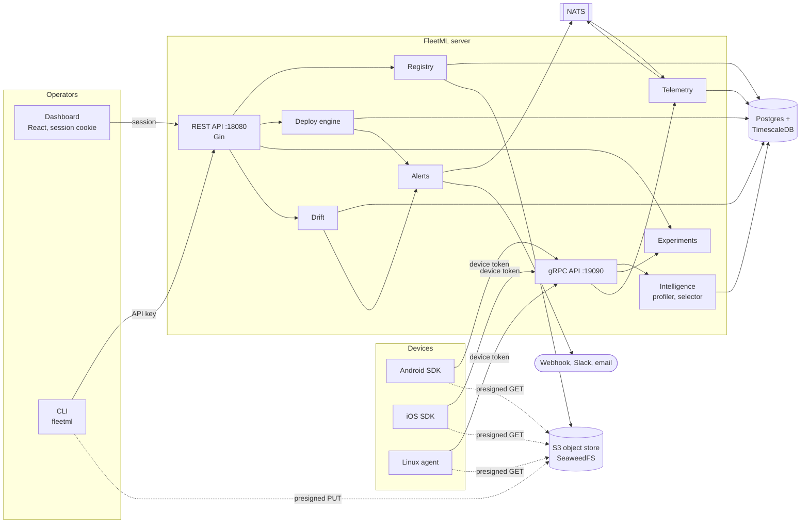
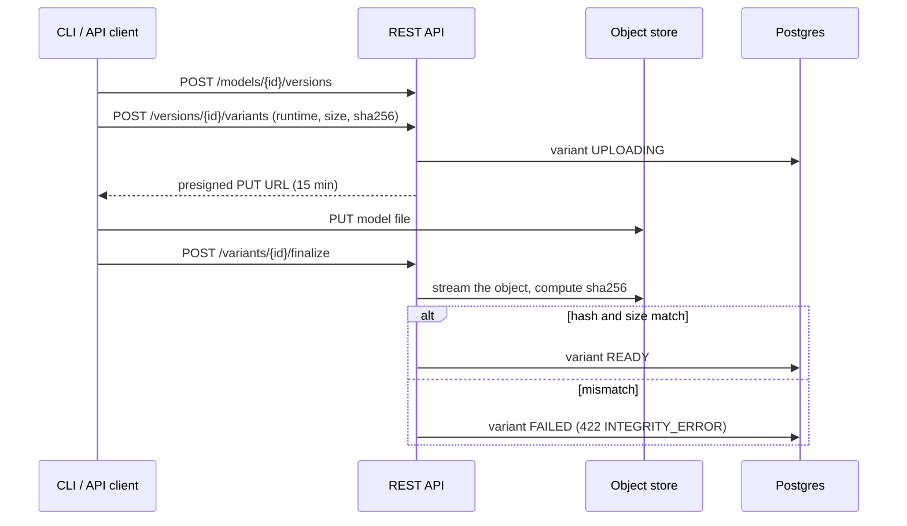
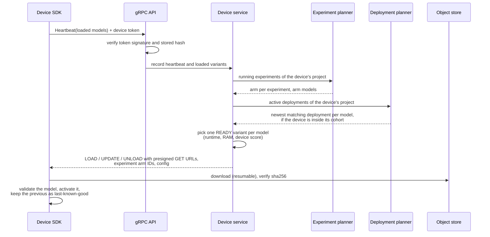
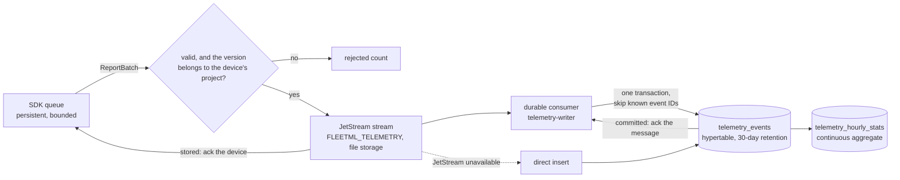
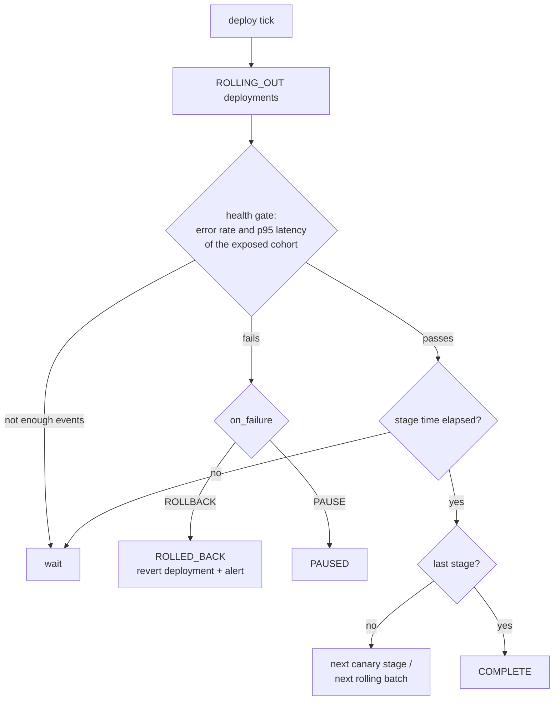
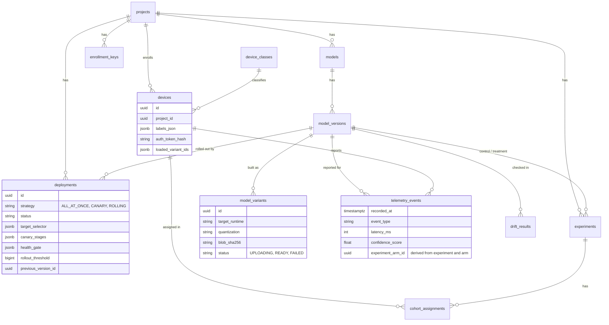
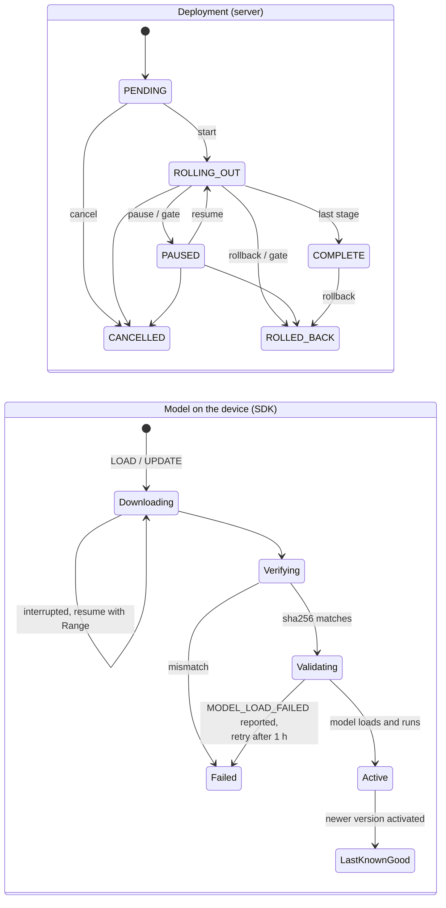
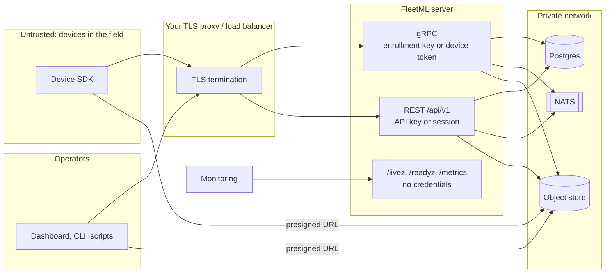

# Architecture

FleetML is one Go server (`cmd/server`) with two APIs, three background loops
and four dependencies, plus device SDKs, a CLI and a web dashboard.



| Package | Responsibility |
|---|---|
| `internal/api/rest` | Admin REST API under `/api/v1`, probes and `/metrics` |
| `internal/api/grpc` | Device gRPC API, device-token interceptor, `grpc.health.v1` |
| `internal/registry` | Projects, models, versions, variants; upload and integrity check |
| `internal/device` | Registration, tokens, heartbeats |
| `internal/intelligence` | Device profiles, variant selection, deployment-to-assignment planning |
| `internal/rollout` | The consistent-hash ring behind canary and rolling cohorts |
| `internal/deploy` | Deployment state machine, health gate, rollback |
| `internal/experiment` | A/B cohorts, arm IDs, Welch test, conclusion |
| `internal/telemetry` | Ingest, NATS pipeline, queries |
| `internal/drift` | PSI drift checks and history |
| `internal/alert` | Rollback and drift alerts on NATS and to per-project sinks (webhook, Slack, email) with retries and a delivery log |
| `internal/auth` | Admin API keys, dashboard sessions and enrollment keys |
| `internal/delta`, `internal/deltabuild` | Binary deltas between consecutive model versions: the format, and building them on the server |
| `internal/signing`, `internal/artifact` | Per-project ed25519 artifact signing keys; what is signed and how a device verifies it |
| `internal/health`, `internal/metrics` | Readiness checks and Prometheus metrics |
| `internal/agent`, `cmd/fleetml-agent` | The Linux device agent (a client of the gRPC API, built separately) |

## Request paths

### Publishing a model

Model files never pass through the server: the client uploads straight to the
object store with a presigned URL, and the server verifies the result.



Only READY variants are ever assigned to devices.

### Device heartbeat

The heartbeat is the control loop: the device reports what it runs and gets
back what it should run.



Planning rules:

- A device only sees deployments and experiments of the project its
  enrollment key belongs to.
- Experiments take precedence over deployments for the models they cover.
- Per model, the newest active deployment that targets the device and exposes
  it wins; a version replaced by another arrives as UPDATE (new) plus UNLOAD
  (old), and the SDK keeps the old one until the new one validates.
- Cohorts come from a consistent-hash ring (`internal/rollout`): a device's
  position is the first four bytes of `sha256(device ID + deployment ID)`.
  Canary stages expose positions below a percentage, rolling batches below a
  growing threshold, so cohorts only grow and health statistics are computed
  over exactly the exposed devices.

### Telemetry



Telemetry is delivered at least once and stored once. `ReportBatch` answers
only after the JetStream stream has stored the batch, and the consumer
acknowledges a message only after its events are committed, so a crash at
any point redelivers instead of losing events. Every event carries an
`event_id` (the SDKs and the agent set one per event, the server assigns one
if it is missing), and `telemetry_events` has a unique index on it, so a
redelivered message, or a batch a device sends again after a lost
acknowledgement, is not stored twice; the stream also drops a batch published
twice within two minutes. A row the database can never accept (an unknown
model version, an invalid value) is dropped and counted; any other failure
(the database is down, a migration is missing) is retried. Lag
(`fleetml_telemetry_consumer_pending`), redeliveries and duplicates are
Prometheus metrics, and `deploy/grafana` has a dashboard for them.

Events for a model in an experiment carry the device's arm ID, so results are
computed per arm.

## Background loops

Three tickers run in the server; their intervals are configurable
([CONFIG.md](CONFIG.md#background-loops)) and each run is counted in
`fleetml_ticker_runs_total`.

| Loop | Default | What it does |
|---|---|---|
| Deploy | 30 s | For each ROLLING_OUT deployment: evaluate the health gate over the exposed cohort, then advance the stage or batch, complete, pause or roll back |
| Experiment | 60 s | Evaluate running experiments once both arms reach the minimum sample (Welch's t-test), conclude expired ones |
| Drift | 5 min | Compare each active version's last 24 h of latency and confidence with the 7 days before (PSI); record changes of severity; alert on a change into CRITICAL |



## Data model



`api_keys` (admin keys, sha256 only) and `audit_logs` stand alone. Experiment
arm IDs are UUIDv5 values derived from the experiment ID and the arm name, not
rows.

## Device protocol

Defined in [`proto/fleetml/v1`](../proto/fleetml/v1).

| RPC | Credential | Purpose |
|---|---|---|
| `DeviceService/Register` | enrollment key | Register (or re-register) by hardware fingerprint; returns device ID, token and `DeviceConfig` |
| `DeviceService/Heartbeat` | device token | Report loaded models; receive assignments, experiment arms, next interval and the current `DeviceConfig` |
| `DeviceService/RefreshToken` | device token | Swap a token in its last 7 days for a new one |
| `TelemetryService/ReportBatch` | device token | Send up to a batch of events; returns accepted and rejected counts |

### What every client implements

The Android and iOS SDKs follow these rules, and any other client (such as a
device agent) must too:

- **Identity.** Register with the enrollment key and a stable fingerprint
  (64 hex characters); keep the token, refresh it in its last 7 days, and
  re-register when a call returns `UNAUTHENTICATED`.
- **Configuration.** Apply `DeviceConfig` from `Register` and from every
  heartbeat: `heartbeat_interval_seconds` while active,
  `background_heartbeat_interval_seconds` while in the background (one
  heartbeat and one telemetry flush per run), `telemetry_batch_size`,
  `telemetry_flush_interval_seconds`, `max_cache_size_mb`, and
  `download_policy`.
- **Downloads.** Download an assignment only when `download_policy` allows it
  (`UNMETERED_OR_CHARGING` by default: an unmetered network, or any network
  while charging; `UNMETERED_ONLY`; `ANY_NETWORK`), unless the assignment is
  `urgent`, which needs only a connection. Resume interrupted downloads with an
  HTTP `Range` request and check the sha256 before using the file. If the
  assignment has a `delta_url` and the device has a file whose sha256 is
  `delta_base_sha256`, it may download the delta (check `delta_sha256`),
  apply it (`internal/delta`, test files in `internal/delta/testdata`) and
  check the result against `blob_sha256`, falling back to `download_url`.
- **Signatures.** Keep the `signing_keys` from `Register` and every heartbeat
  (replace the stored set each time) and, before downloading an assignment,
  verify its `signature` with the key `signing_key_id` over
  `fleetml-artifact-v1\n<model_id>\n<version>\n<sha256 lowercase>`. Reject it
  if the key is unknown, its `not_after` has passed, or the signature does not
  verify; then keep the current version and report `SIGNATURE_INVALID`. Accept
  unsigned assignments only while no keys are known (a server without
  signing). `internal/artifact/testdata/vectors.json` has cases every client
  must agree on.
- **Activation.** Validate a downloaded model before switching to it; on
  failure keep the current version (last-known-good) and report
  `MODEL_LOAD_FAILED`. A replacement arrives as `UPDATE` (new) plus `UNLOAD`
  (old): keep the old one until the new one is active.
- **Telemetry.** Queue events persistently, send them in batches (never one
  request per event), give each event an `event_id` (a UUID, kept with the
  queued event so a resent batch is recognised), tag events of a model in an
  experiment with its `arm_id`, and back off after failures. Bin input feature values with the
  model's `DeviceConfig.feature_bins` (a value `v` falls into bin `i` where
  `edges[i-1] <= v < edges[i]`) and send only the counts.

Deployments and the model lifecycle on a device:



## Users, roles and the audit log

Every API key belongs to a user. A user is either a **global admin** (every
project, users, API keys, creating projects; the `bootstrap` user that owns
`FLEETML_ADMIN_KEY` is one) or has a role in individual projects:

| Role | May |
|---|---|
| `viewer` | read everything in the project: models, deployments, experiments, devices, telemetry, drift, alert sinks (secrets redacted), the signing key |
| `operator` | also publish models (versions, variants, features), create and control deployments and experiments, run drift checks, send test alerts |
| `admin` | also delete, manage enrollment keys, alert sinks and the signing key, edit the project, manage its members, read its audit log |

```bash
U=$(api POST /api/v1/users '{"name":"vera"}' | jq -r .data.id)              # global admin only
api POST /api/v1/users/$U/api-keys '{"name":"laptop"}'                         # the key is shown once
api PUT /api/v1/projects/$P/members "{\"user_id\":\"$U\",\"role\":\"viewer\"}"   # project admin
```

The permission matrix (`internal/api/rest/permissions.go`) lists the role and
the project of every route; a route that is not in it is refused, and a test
checks that the matrix and the router agree and runs every route for every
kind of caller. A request for a resource of another project, or one that does
not exist, is refused with 403, so other projects' resources are not revealed.
Lists that span projects (`GET /projects`, `/devices`, `/deployments`,
`/experiments`) show only the caller's projects, and users see and revoke only
their own dashboard sessions.

Every request that changes something, and every refused request, is written
to the audit log with the user, the API key, the route, the project, the
status and the client address. `GET /audit` filters it (`project_id`,
`actor`, `action`, `outcome=allowed|denied`, `from`, `to`, `limit`) and
`GET /audit/export` returns the same as CSV; project admins read their
project's entries, global admins all. The dashboard's Audit page shows it.

## Trust boundaries



| Credential | Held by | Grants | Lifetime |
|---|---|---|---|
| API key | one user | what the user's role in each project allows (a global admin: every route) | until revoked |
| Dashboard session | one browser (`httpOnly`, `SameSite=Strict` cookie, plus a CSRF token for writes) | what its API key grants | `SESSION_TTL` (12 h), revocable, ends with its key |
| Enrollment key | apps (built in) | registering a device into one project | until rotated or revoked |
| Device token | one device | its own heartbeats, token refresh and telemetry, within its project | 30 days by default, refreshable, revocable |
| Presigned URL | one client | reading (1 h) or writing (15 min) one object | until it expires |
| Webhook secret | server and receiver | proves an alert came from this server (HMAC-SHA256) | until changed |

The server keeps only hashes of API keys, session tokens, enrollment keys and
device tokens.
Devices verify every model's sha256 before use, so a tampered object store or
download cannot activate a different file. TLS is not built in: terminate it in
front of the server (see [SECURITY.md](../SECURITY.md)).
