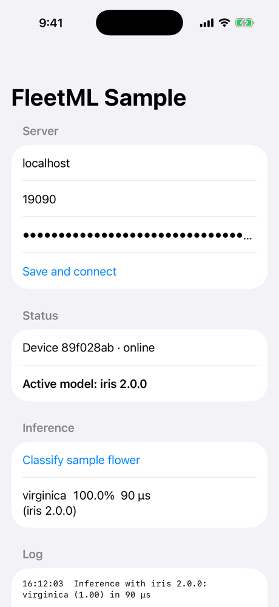
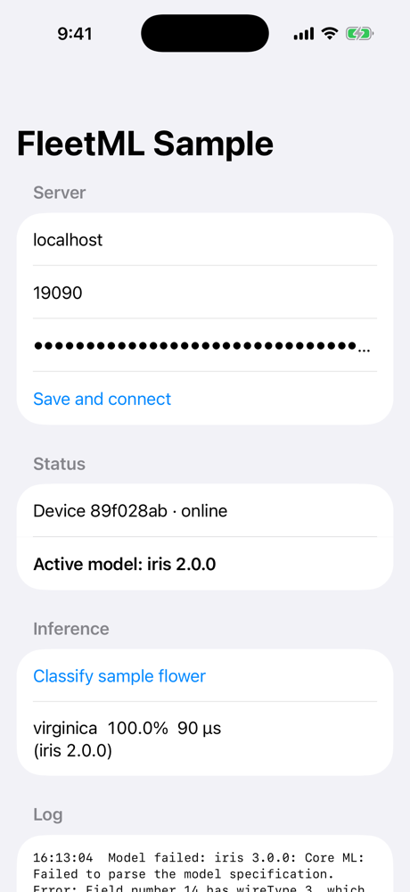
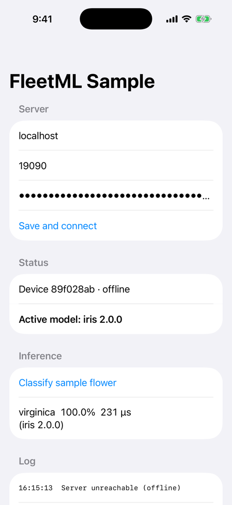

# iOS SDK

The FleetML iOS SDK (`ios/FleetMLSDK`, a Swift package for iOS 15 and later)
puts an iPhone or iPad app under FleetML's control: it registers with an
enrollment key, receives model assignments over gRPC, downloads and verifies
them, validates each model with Core ML before using it, keeps the
last-known-good version, works offline, and reports telemetry. It does not run
your models: your app does, with Core ML or anything else. It mirrors the
[Android SDK](ANDROID_SDK.md) feature for feature.



## Install

The package is not published to a registry yet. Add it from this repository
in Xcode (**File → Add Package Dependencies → Add Local…**, pick
`ios/FleetMLSDK`) or in a `Package.swift`:

```swift
.package(path: "path/to/fleetml/ios/FleetMLSDK"),
// target dependency:
.product(name: "FleetMLSDK", package: "FleetMLSDK"),
```

It depends on grpc-swift 1.27 (the release line that supports iOS 15) and
swift-protobuf. macOS 12 is supported too, for tests and tools.

## Configure and start

Initialize once, for example in your `App` or app delegate:

```swift
import FleetMLSDK

final class AppModel: FleetMLDelegate {
    init() {
        try? FleetML.initialize(
            config: FleetMLConfig(serverHost: "fleetml.example.com", enrollmentKey: enrollmentKey,
                                  labels: ["region": "eu", "tier": "beta"]),
            delegate: self)
    }

    func fleetML(modelReady model: ActiveModel) {
        // model.fileURL is verified and validated: load it.
    }
}
```

| `FleetMLConfig` field | Default | Purpose |
|---|---|---|
| `serverHost`, `serverPort` | –, `19090` | The FleetML gRPC endpoint |
| `enrollmentKey` | `""` | Per-project key for the first registration (`POST /api/v1/projects/{id}/enrollment-keys`) |
| `useTLS` | `false` | TLS for gRPC (put the server behind a TLS proxy in production) |
| `labels` | `[:]` | Labels deployments and experiments target (`target_selector`) |
| `heartbeatIntervalSeconds` | `30` | Foreground heartbeat interval, until the server sends its own |
| `backgroundHeartbeatIntervalSeconds` | `3600` | Earliest interval of the background refresh, until the server sends its own (at least 15 minutes) |
| `telemetryBatchSize`, `telemetryFlushIntervalSeconds` | `50`, `30` | Until the server's `DeviceConfig` overrides them |
| `maxCacheSizeMB` | `500` | Disk budget for models; the active and last-known-good models are never evicted |
| `downloadPolicy` | `.unmeteredOrCharging` | Which networks non-urgent downloads may use, until the server sends its own ([Battery and data](#battery-and-data)) |
| `autoStart` | `true` | Call `FleetML.start()` yourself if `false` |

`FleetML.stop()` stops background work so `initialize` can be called again
(for example with a new server address). `FleetML.reset()` also deletes cached
models and the registration. Delegate methods have empty default
implementations and are called on a background queue.

## Enrollment and identity

The first registration needs a valid enrollment key; the device is enrolled
into that key's project and receives a device token (30 days by default),
stored in the Keychain (this device only, available after first unlock). The
device ID is stable per app and device: the fingerprint is a SHA-256 of the
bundle identifier and hardware properties (no identifierForVendor or
advertising identifier), so two FleetML apps on one phone are separate
devices. A device only ever receives deployments and experiments of its own
project. After registering, the SDK:

- re-registers only when it is new or its labels or SDK version changed;
- refreshes the token before it expires (6 days before, or at half its lifetime
  for short-lived tokens);
- re-registers with the enrollment key if the server rejects the token.

## Models: download, verify, validate, activate

For each assignment in a heartbeat the SDK:

1. **Checks the signature** of the assignment with the project's signing
   keys (sent with registration and every heartbeat): an artifact whose
   signature does not verify is not downloaded, the current model stays, and
   `SIGNATURE_INVALID` is reported ([artifact signing](ROLLOUTS.md#artifact-signing)).
2. **Downloads** the model from the presigned URL, writing each chunk to a
   `.part` file as it arrives. An interrupted download resumes with an HTTP
   Range request.
3. **Verifies** the sha256 before moving the file into place.
4. **Validates** it with a `ModelValidator`.
5. **Activates** it only if validation passed: the model becomes active, the
   previously active version becomes last-known-good, the device reports the
   new version as loaded and `fleetML(modelReady:)` is called.

If validation fails, the active (last-known-good) model stays in place, the SDK
reports a `MODEL_LOAD_FAILED` event with the error (so a canary's health gate
can roll the release back), calls `fleetML(modelLoadFailed:version:reason:)`,
and does not retry that variant for an hour.



### Validators

`ModelValidators.default()` (used unless you pass `validator:` to
`initialize`) compiles the model with Core ML, loads it and, when every input
is a multi-array, runs one prediction on zeros. TensorFlow Lite files
(identifier `TFL3`) are accepted as they are, because iOS has no TFLite
runtime of its own. Write your own to check what matters to your app:

```swift
struct GoldenInputValidator: ModelValidator {
    func validate(fileURL: URL, model: ActiveModel) -> ValidationResult {
        runGoldenInput(fileURL) ? .valid : .invalid("golden input mismatch")
    }
}
try FleetML.initialize(config: config, delegate: self, validator: GoldenInputValidator())
```

Delivered files keep the server's name (`{variant}.bin`); Core ML compiles from
a path ending in `.mlmodel`, so copy the file to one before
`MLModel.compileModel(at:)` (the sample app's `IrisClassifier` shows how).

### Which variant a device gets

iOS devices register with OS `IOS`, and the server prefers `COREML` variants
for them (then `TFLITE`, then `GGUF`). Requirements default by quantization
(for example FP32 needs a device score of 60 and 2 GB of RAM); override them for
small models in the version's metadata:

```json
{"version": "1.0.0", "metadata": {"fleetml_requirements": {"min_ram_mb": 64, "min_score": 0}}}
```

## Battery and data

| | In the foreground | In the background |
|---|---|---|
| Heartbeat | every `heartbeat_interval_seconds` (server default 60 s) | one per background refresh |
| Telemetry | batches of `telemetry_batch_size` (100), every `telemetry_flush_interval_seconds` (30 s) and when a batch fills | one flush when the app goes to the background, one per background refresh |
| Background refresh | not scheduled | a `BGAppRefreshTask` no earlier than `background_heartbeat_interval_seconds` (1 h, at least 15 min); iOS decides the exact time |
| Model downloads | per `download_policy` | per `download_policy` |

- **Foreground only timers.** The SDK stops its timers when the app enters the
  background and starts them when it returns. To get the background refresh,
  add `com.fleetml.sdk.refresh` (`FleetML.backgroundTaskIdentifier`) to
  `BGTaskSchedulerPermittedIdentifiers` in your `Info.plist`, enable the
  "Background fetch" mode (`UIBackgroundModes`: `fetch`), and call
  `FleetML.registerBackgroundTask()` and `FleetML.initialize` before the app
  finishes launching (the sample app does both in its `App` initializer).
  `FleetML.syncNow()` runs one heartbeat and one telemetry flush on demand.
- **Downloads.** `.unmeteredOrCharging` (the default): a network that is
  neither expensive (cellular, personal hotspot) nor constrained (Low Data
  Mode), or any network while the device charges. `.unmeteredOnly` and
  `.anyNetwork` are the alternatives. A waiting assignment is retried on the
  next heartbeat. Assignments of an
  [urgent deployment](ROLLOUTS.md#urgent-deployments-and-the-download-policy),
  and every rollback, download on any connected network.
- **Telemetry** is always batched; no event is sent on its own.
- The server sets all of these for every device with the `DEVICE_*`
  variables ([CONFIG.md](CONFIG.md#devices)); `FleetMLConfig` only provides
  the values used before the first response.
- The iOS Simulator cannot run background tasks (`BGTaskScheduler` reports
  it unavailable); test the background refresh on a device with Xcode's
  `e -l objc -- (void)[[BGTaskScheduler sharedScheduler] _simulateLaunchForTaskWithIdentifier:@"com.fleetml.sdk.refresh"]`.

## Offline behaviour

Models activated in an earlier run are delivered through
`fleetML(modelReady:)` (and `FleetML.activeModels`) as soon as the SDK starts,
before the server is reached. Until the server answers, the app keeps using its
cached models; `fleetML(connectionChanged:)` reports reachability within about
ten seconds.



## Telemetry

```swift
if let model = FleetML.activeModel(named: "iris") {
    FleetML.telemetry?.reportInference(model: model, latencyMs: 3, confidence: 0.97, label: "virginica")
    // with input values, for feature-level drift (only features configured on the server are kept):
    FleetML.telemetry?.reportInference(model: model, latencyMs: 3, features: ["petal_length": [5.1]])
}
```

Events go into a persistent queue (bounded to 10,000; oldest dropped first):
they survive app termination and are kept while offline or before
registration. They are sent in batches every flush interval, with exponential
backoff (5 s up to 5 min) after a failure and an immediate flush when the
connection returns. For a model in an A/B experiment the event carries the
device's arm ID automatically. Feature values are binned on the device with
the edges from the server ([feature-level drift](ROLLOUTS.md#feature-level-drift));
only the counts are sent.

## Tests

```bash
make ios-test                     # swift test: 47 XCTests on macOS
cd ios/FleetMLSDK && xcodebuild test -scheme FleetMLSDK \
  -destination 'platform=iOS Simulator,name=iPhone 17 Pro'   # the same suite on a simulator
FLEETML_API_KEY=<admin key> ./scripts/ios-e2e.sh            # live test against make dev
FLEETML_API_KEY=<admin key> ./scripts/signing-e2e.sh ios     # signatures: tampered, and the rotation grace
```

`scripts/ios-e2e.sh` creates a non-urgent deployment and runs
`LiveServerTests` on the simulator: a device on an expensive network and on
battery registers, its model waits, then an urgent deployment downloads and
activates. Without the script's environment the live test is skipped.

The suite covers the telemetry queue and reporter, the model store, the
downloader (including an interrupted transfer resumed with Range), cache
eviction, the model manager (activation, last-known-good, UPDATE + UNLOAD,
restart), the token refresh policy, the heartbeat loop and the Core ML
validator on the real Iris model, the battery and data policy, and signature
checks against the shared vectors in `internal/artifact/testdata`. `make proto-swift` regenerates the gRPC
client code from `proto/`.

## Simulator runbook

This is how the SDK and sample app were verified, against the dev stack on the
host machine (the simulator shares the host's `localhost`, so no
`S3_PUBLIC_ENDPOINT` is needed). It needs Xcode and
[XcodeGen](https://github.com/yonaskolb/XcodeGen) (`brew install xcodegen`).

1. Start the server: `make dev`.

2. Upload the Core ML sample models, create an enrollment key and deploy v1 to
   the sample app's label (`app=sample`):

   ```bash
   export FLEETML_API_KEY=$(grep '^FLEETML_ADMIN_KEY=' .env | cut -d= -f2)
   api() { curl -s -X "$1" -H "Authorization: Bearer $FLEETML_API_KEY" -H 'Content-Type: application/json' -d "$3" "localhost:18080$2"; }
   upload() { local out=$(api POST /api/v1/versions/$1/variants "{\"quantization\":\"FP32\",\"target_runtime\":\"COREML\",\"blob_size_bytes\":$(wc -c < $2 | tr -d ' '),\"blob_sha256\":\"$(shasum -a 256 $2 | cut -d' ' -f1)\"}")
     curl -s -o /dev/null -X PUT --data-binary @$2 "$(echo "$out" | jq -r .data.upload_url)"
     api POST /api/v1/variants/$(echo "$out" | jq -r .data.variant.id)/finalize "" | jq -r .data.status; }
   P=$(api POST /api/v1/projects '{"name":"ios-demo"}' | jq -r .data.id)
   M=$(api POST /api/v1/projects/$P/models '{"name":"iris","framework":"COREML","task_type":"CLASSIFICATION"}' | jq -r .data.id)
   REQ='{"fleetml_requirements":{"min_ram_mb":64,"min_score":0}}'
   V1=$(api POST /api/v1/models/$M/versions "{\"version\":\"1.0.0\",\"metadata\":$REQ}" | jq -r .data.id); upload $V1 models/iris/iris_v1.mlmodel
   V2=$(api POST /api/v1/models/$M/versions "{\"version\":\"2.0.0\",\"metadata\":$REQ}" | jq -r .data.id); upload $V2 models/iris/iris_v2.mlmodel
   EK=$(api POST /api/v1/projects/$P/enrollment-keys '{"name":"simulator"}' | jq -r .data.key); echo "enrollment key: $EK"
   D=$(api POST /api/v1/deployments "{\"project_id\":\"$P\",\"model_version_id\":\"$V1\",\"target_selector\":{\"app\":\"sample\"}}" | jq -r .data.id)
   api POST /api/v1/deployments/$D/start "" | jq -r .data.status
   ```

3. Generate the Xcode project, build, install and launch the sample app with
   the settings as launch arguments (or open `ios/SampleApp/FleetMLSample.xcodeproj`,
   run it and type them on the config screen):

   ```bash
   cd ios/SampleApp && xcodegen generate
   xcodebuild -project FleetMLSample.xcodeproj -scheme FleetMLSample \
     -destination 'platform=iOS Simulator,name=iPhone 17 Pro' -derivedDataPath build build
   xcrun simctl boot 'iPhone 17 Pro'; open -a Simulator
   xcrun simctl install booted build/Build/Products/Debug-iphonesimulator/FleetMLSample.app
   xcrun simctl launch --console-pty booted com.fleetml.sample -fleetmlHost localhost -fleetmlEnrollmentKey "$EK"
   ```

   The app registers, downloads iris 1.0.0, validates it with Core ML, shows
   **Active model: iris 1.0.0** and classifies the sample flower with it,
   reporting inference telemetry. Deploying `$V2` updates the app to 2.0.0
   (1.0.0 is kept as last-known-good).

4. Offline start: stop the server, then
   `xcrun simctl terminate booted com.fleetml.sample` and launch the app again.
   The cached model is active immediately and inference works; events are
   queued and sent once the server is back.

## Sample app

`ios/SampleApp` is the reference integration, generated with XcodeGen from
`project.yml`: a SwiftUI config screen (host, port, enrollment key), the SDK
owned by an app-wide object, the Iris Core ML model from `models/iris`
(Apache-2.0) bundled and used until the server assigns one, and inference
telemetry. Its `Info.plist` sets `NSAllowsLocalNetworking` so model downloads
from a dev stack on `localhost` work over plain HTTP; production servers
should serve presigned URLs over HTTPS.
