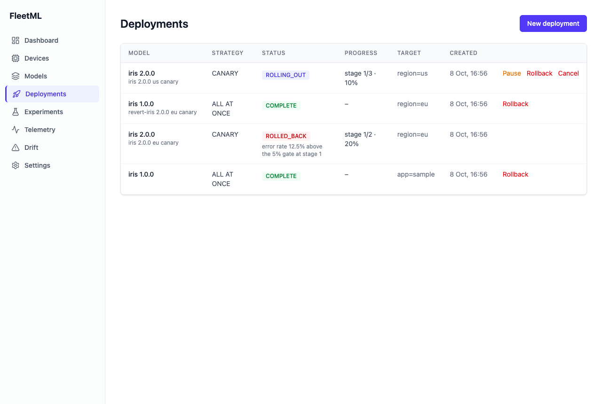

# Quickstart and tour

Run FleetML in containers, then walk through every feature against it with a
fleet of simulated devices. Each block of the quickstart and the tour below
was run as written, in order.

## Run FleetML

Needs Docker with Compose v2 and `openssl`. The dashboard uses port 80; the
APIs use 18080 (REST) and 19090 (gRPC); model files are served on 19100
(`FLEETML_S3_PUBLIC_PORT` moves it, see [CONFIG.md](CONFIG.md#docker-compose)).
The first start takes a few minutes on a cold Docker cache, to pull the base
images and build the server and dashboard, and well under a minute when the
images are cached.

In bash or zsh (on Windows, in the WSL 2 Ubuntu shell, see [On Windows](#on-windows)):

```bash
git clone https://github.com/fleetml/fleetml.git && cd fleetml
export JWT_SECRET=$(openssl rand -base64 32) SIGNING_MASTER_KEY=$(openssl rand -base64 32) FLEETML_ADMIN_KEY=$(openssl rand -hex 32)
docker compose -f deploy/docker-compose.prod.yml up -d --build
until curl -sf localhost:18080/readyz; do sleep 2; done; echo
curl -s -H "Authorization: Bearer $FLEETML_ADMIN_KEY" localhost:18080/api/v1/projects; echo
echo "Dashboard: http://localhost  (log in with the admin API key: $FLEETML_ADMIN_KEY)"
```

**Save the three values now.** They exist only in this shell. The admin key
is how you log in to the dashboard and how the CLI and the REST API reach the
server, and the server stores it on the first start only: later starts
ignore `FLEETML_ADMIN_KEY`, so a lost key cannot be replaced by exporting a
new one (the way back is `down -v` and a fresh start, which deletes the data).
Compose reads `JWT_SECRET` and `SIGNING_MASTER_KEY` for every command on this
stack, `down` included. In bash or zsh, this writes them to a file only you
can read, and `source ~/.fleetml.env` brings them back in a new shell
(the [tour](#tour) adds its own values to the same file):

```bash
(umask 077; printf "export JWT_SECRET='%s' SIGNING_MASTER_KEY='%s' FLEETML_ADMIN_KEY='%s'\n" "$JWT_SECRET" "$SIGNING_MASTER_KEY" "$FLEETML_ADMIN_KEY" > ~/.fleetml.env)
```

`/readyz` answers `{"db":"connected","nats":"connected","s3":"connected","status":"ok"}`
once Postgres, the object store and NATS are reachable, and the project list
answers `{"data":[],"pagination":{...}}`: no projects yet. If nothing
appears after about two minutes more than the build took, run
`docker compose -f deploy/docker-compose.prod.yml ps -a` and
`docker compose -f deploy/docker-compose.prod.yml logs server` to see which
container stopped and why (a port already in use is the usual cause). On
Windows, a port can also sit in a range that Hyper-V or WSL reserves: Docker
then fails with `bind: An attempt was made to access a socket in a way
forbidden by its access permissions`, and
`netsh int ipv4 show excludedportrange protocol=tcp` in PowerShell lists the
reserved ranges; move the port out of them (below for port 80,
`FLEETML_S3_PUBLIC_PORT` for 19100). More keys and their routes:
[API keys](CONFIG.md#api-keys).

If port 80 is taken (by IIS or a VPN agent on Windows, for example), move the
dashboard to any free port with an override file and open it on that port,
here http://localhost:8081. `!override` needs Compose 2.24 or later:
`docker compose version` prints the version (for example
`Docker Compose version v2.39.4-desktop.1`); older versions do not know the
tag. This override is not exercised by CI:

```bash
printf 'services:\n  dashboard:\n    ports: !override ["8081:80"]\n' > dashboard-port.yml
docker compose -f deploy/docker-compose.prod.yml -f dashboard-port.yml up -d --build
```

### On Windows

How it fits together:

- **Ubuntu (WSL 2) shell:** the stack, the Run FleetML block, the tour and
  the scripts, in a clone under `~` in the Linux file system.
- **PowerShell:** the Windows `fleetml.exe` for single commands, the
  dashboard in a Windows browser, and the Android tools (`adb`, Gradle).
- **The admin key** is created in the Ubuntu shell and saved in
  `~/.fleetml.env` there; PowerShell reads it with the `wsl` line below, or
  you paste it once into `fleetml config set-key`.
- **Two clones** when you build the Android sample app: the one in Ubuntu
  for the stack, and one on the Windows side for Gradle, which is slow on a
  `\\wsl.localhost` path.

The server, Postgres, NATS and the object store are Linux containers, and the
quickstart, the tour and the scripts are bash, so on Windows they run in a
WSL 2 shell with Docker Desktop's WSL 2 backend. Docker Desktop runs on 64-bit
Windows 11 23H2 or later and Windows 10 22H2, with WSL 2.1.5 or later; Home
editions run only Linux containers, which is all FleetML uses. See Docker's
[system requirements](https://docs.docker.com/desktop/setup/install/windows-install/)
for the current list.
Docker labels Docker Desktop for Windows on Arm early access, so Arm laptops
are not a tested path.

1. Install [Docker Desktop](https://docs.docker.com/desktop/setup/install/windows-install/)
   and keep **Use the WSL 2 based engine** on (Settings → General). The
   installer needs an administrator; a daily account that is not one must be
   in the local `docker-users` group to use Docker Desktop (Computer
   Management, Local Users and Groups, then sign out and in again).
2. In PowerShell opened as administrator (right-click, **Run as
   administrator**), `wsl --install -d Ubuntu` installs WSL 2 and Ubuntu.
   Restart Windows if it asks to; WSL 2 also needs virtualization turned on
   in the firmware (BIOS or UEFI), which most laptops have on, and an error
   that mentions virtualization or "Virtual Machine Platform" means it is
   off. Then open the **Ubuntu** shell from the Start menu and create its
   user. WSL 2 gives Linux half of the machine's memory by default, which
   on an 8 GB laptop is about the 2 GB the stack and its two image builds
   need plus little else; a `%UserProfile%\.wslconfig` with `[wsl2]` and
   `memory=6GB`, then `wsl --shutdown`, gives it more.
3. Start Docker Desktop, and in its Settings → Resources → WSL integration,
   turn on integration for Ubuntu. `docker` in the Ubuntu shell works only
   while Docker Desktop is running; "Cannot connect to the Docker daemon"
   there means it is not, or that the integration was turned on after the
   shell opened (open a new Ubuntu shell).
4. In the Ubuntu shell: `sudo apt update && sudo apt install -y git jq`
   (`curl` and `openssl` are already there), then `cd ~` and run the
   [Run FleetML](#run-fleetml) block as it is, then the "Save the three
   values" block under it. Keep the clone in the Linux file system (`~`), not
   under `/mnt/c`: files under `/mnt/c` are much slower to read from WSL.
5. For the tour, install the Linux CLI in the same shell with the first block
   of [Get the CLI](#get-the-cli). To build it from source instead, install
   Go 1.24 or later from [go.dev](https://go.dev/doc/install): Ubuntu's
   `golang` package is older.

Docker Desktop publishes the containers' ports on Windows too, so the
dashboard opens in a Windows browser at http://localhost, and PowerShell
reaches the REST API at `localhost:18080` (for example
`Invoke-RestMethod http://localhost:18080/readyz`). The tour below runs only
in the Ubuntu shell, since its blocks are bash and use `jq`; single CLI
commands, such as `fleetml project list` or a push, work from PowerShell too
with the CLI from [Get the CLI](#get-the-cli).
PowerShell and the Windows browser need the admin key too: in the Ubuntu shell,
`echo $FLEETML_ADMIN_KEY` prints it (after `source ~/.fleetml.env` in a new
one), to paste into `$env:FLEETML_API_KEY = '<the admin key>'` or the
dashboard's login. Or let PowerShell read it from the saved file:

```powershell
$env:FLEETML_API_KEY = wsl -d Ubuntu --exec bash -c '. ~/.fleetml.env && printf %s $FLEETML_ADMIN_KEY'
```

(`--exec` runs bash directly; without it, Ubuntu's login shell reads the line
first and can replace `$FLEETML_ADMIN_KEY` with nothing. The Windows run
uses the same `wsl ... --exec bash -c` line, on the file its own script
writes, `~/.fleetml-run.env`, rather than this one.)

`$env:` lasts for that PowerShell window; `fleetml config set-key <the admin key>`
saves it for every window instead, in `%USERPROFILE%\.fleetml\config.yaml`
([CONFIG.md](CONFIG.md#cli)).

What the [Windows run](../.github/workflows/windows-run.yml) workflow checks
on GitHub's Windows runner: the Run FleetML block and tour sections 1 to 3 in
WSL 2 Ubuntu, with Docker Engine installed inside the distribution (Docker
Desktop cannot be installed on the runner) and WSL's own `localhost`
forwarding; `/readyz` and `fleetml project list` from PowerShell against that
server; and the PowerShell block of [Get the CLI](#get-the-cli). In WSL it
builds the CLI from source (the tour's first block) rather than installing
the Linux release as step 5 does. Docker Desktop itself (steps 1 and 3, the
ports it publishes) and the port-80 override are not exercised by CI.

## Get the CLI

`fleetml` is a single binary for macOS, Linux and Windows on amd64 and arm64,
attached to every [GitHub release](https://github.com/fleetml/fleetml/releases)
with a `SHA256SUMS` file:

| OS | Asset | Binary |
|---|---|---|
| Linux | `fleetml-linux-amd64.tar.gz`, `fleetml-linux-arm64.tar.gz` | `fleetml` |
| macOS | `fleetml-darwin-amd64.tar.gz`, `fleetml-darwin-arm64.tar.gz` | `fleetml` |
| Windows | `fleetml-windows-amd64.zip`, `fleetml-windows-arm64.zip` | `fleetml.exe` |

On macOS and Linux (and in WSL), the latest release, checked and put in
`~/.local/bin` on the `PATH`, without `sudo` (on Linux without Perl,
`sha256sum -c` replaces `shasum -a 256 -c`):

```bash
OS=$(uname -s | tr '[:upper:]' '[:lower:]'); ARCH=$(uname -m | sed -e 's/x86_64/amd64/' -e 's/aarch64/arm64/')
curl -fsSLO "https://github.com/fleetml/fleetml/releases/latest/download/fleetml-$OS-$ARCH.tar.gz"
curl -fsSLO https://github.com/fleetml/fleetml/releases/latest/download/SHA256SUMS
grep " fleetml-$OS-$ARCH.tar.gz\$" SHA256SUMS | shasum -a 256 -c
tar -xzf "fleetml-$OS-$ARCH.tar.gz" fleetml && mkdir -p ~/.local/bin && mv fleetml ~/.local/bin/
export PATH="$HOME/.local/bin:$PATH"
fleetml version
```

The `export` lasts for this shell; put it in `~/.bashrc` or `~/.zshrc` to
keep it (many Linux distributions already have `~/.local/bin` on the
`PATH`). For every user of the machine instead, `sudo mv fleetml /usr/local/bin/`
in place of the `mkdir` and `mv`.

On Windows, in PowerShell, into `%LOCALAPPDATA%\fleetml`, added to the user's
`PATH`:

```powershell
$arch = if ($env:PROCESSOR_ARCHITECTURE -eq 'ARM64') { 'arm64' } else { 'amd64' }
$base = 'https://github.com/fleetml/fleetml/releases/latest/download'
Invoke-WebRequest "$base/fleetml-windows-$arch.zip" -OutFile fleetml.zip -UseBasicParsing
Invoke-WebRequest "$base/SHA256SUMS" -OutFile SHA256SUMS -UseBasicParsing
$want = (Select-String -Path SHA256SUMS -Pattern " fleetml-windows-$arch.zip$").Line.Split(' ')[0]
if ((Get-FileHash fleetml.zip -Algorithm SHA256).Hash -ne $want) { throw 'fleetml.zip does not match SHA256SUMS' }
Expand-Archive fleetml.zip -DestinationPath "$env:LOCALAPPDATA\fleetml" -Force
[Environment]::SetEnvironmentVariable('Path', [Environment]::GetEnvironmentVariable('Path', 'User') + ";$env:LOCALAPPDATA\fleetml", 'User')
$env:Path += ";$env:LOCALAPPDATA\fleetml"
fleetml version
```

The PowerShell block leaves `fleetml.zip` and `SHA256SUMS` in the folder it
ran in; delete them once `fleetml version` answers. Running it again adds
`%LOCALAPPDATA%\fleetml` to the user `Path` a second time, which does no
harm (Settings, System, About, Advanced system settings, Environment
Variables removes the copy). A zip downloaded with a browser instead carries
the mark of the web, which is what brings SmartScreen's prompt (below);
`Unblock-File` on the zip before `Expand-Archive`, or on `fleetml.exe`
after, removes it. Its `PATH` line writes
the user `Path` back as a plain string (`REG_SZ`): a `Path` that was
`REG_EXPAND_SZ`, with entries such as `%USERPROFILE%\bin`, keeps working,
but those entries are stored expanded from then on.

If the first `Invoke-WebRequest` fails with a secure-channel (SSL/TLS) error
on an older Windows, run `[Net.ServicePointManager]::SecurityProtocol = 'Tls12'`
first.

The amd64 binary and this block are exercised in Windows PowerShell 5.1 on
GitHub's Windows runner by the
[Windows run](../.github/workflows/windows-run.yml) workflow; the arm64
binary is cross-compiled and not yet run on Windows on Arm.

`fleetml.exe` is not code-signed. Started from a terminal as above, it runs
like any console program; a copy downloaded with a browser and started from
Explorer may get SmartScreen's "Windows protected your PC" prompt (More info,
Run anyway), and antivirus or a company policy may scan or block an unsigned
program. The CLI keeps its settings in `%USERPROFILE%\.fleetml\config.yaml`
([CONFIG.md](CONFIG.md#cli)).

`fleetml version` prints the release, for example `✓ fleetml v0.6.0`. In PowerShell,
point it at the server with `$env:FLEETML_SERVER = 'http://localhost:18080'`
and `$env:FLEETML_API_KEY = '<the admin key>'` (or the `wsl` line in
[On Windows](#on-windows)), or once for every window with
`fleetml config set-key <the admin key>`, which saves the key in
`%USERPROFILE%\.fleetml\config.yaml`; then `fleetml project list`
prints the same projects as in WSL (`No results.` before the tour). Pushing
from Windows works too, because Docker Desktop also publishes the object
store's port 19100 on Windows. With a clone on the Windows side (which the
Android SDK's Windows steps use anyway), from its folder:
`fleetml push models\iris\iris_v1.tflite --project <project ID> --model iris --version 1.0.0`;
or with the clone in the Ubuntu file system, which Windows sees under
`\\wsl.localhost\Ubuntu` (`<user>` is the Ubuntu user):
`fleetml push \\wsl.localhost\Ubuntu\home\<user>\fleetml\models\iris\iris_v1.tflite --project <project ID> --model iris --version 1.0.0`
(neither is verified on Windows by CI: the Windows run pushes from Windows
only to a stand-in for the REST API).
Windows PowerShell 5.1, the one built into Windows, drops the inner double
quotes of an argument it passes to a program, so a JSON flag needs them
escaped: `--target '{\"app\":\"tour\"}'`. PowerShell 7.3 and later pass
`--target '{"app":"tour"}'` as written; there, do not escape.
`$PSVersionTable.PSVersion` prints which one a window runs (Windows Terminal
may open either). The wrong form for the version is refused before anything
is created: unescaped in 5.1 with
`Error: invalid --target JSON: invalid character 'a' looking for beginning of object key string`,
escaped in 7.3 with
`Error: invalid --target JSON: invalid character '\\' looking for beginning of object key string`.
In Windows PowerShell 5.1 with a console code page other than UTF-8, the
`✓` of `fleetml version` may show as `?`; the program is the same.

From source, with Go 1.24 or later: `go build -o bin/fleetml ./cmd/fleetml`
in the repository (it reports its version as `dev`).

The server image contains the CLI too, so without installing anything,
`docker compose -f deploy/docker-compose.prod.yml exec -e FLEETML_API_KEY=$FLEETML_ADMIN_KEY server fleetml project list`
runs it next to the server. Every command works that way except
`fleetml push`: its upload goes to `localhost:19100`, which inside the
container is not the object store.

## Tour

The tour runs from the repository root, in the same shell as the stack (it
uses `FLEETML_ADMIN_KEY`), and needs `jq` and the `fleetml` CLI on the `PATH`:
the release from [Get the CLI](#get-the-cli). Without it, build the CLI from
source with Go 1.24 or later and put it on the `PATH` for this shell:

```bash
go build -o bin/fleetml ./cmd/fleetml && export PATH="$PWD/bin:$PATH"
```

The blocks are written to paste into bash or zsh as they are: what a command
prints is given in the text, not in `#` comments, which zsh at the prompt
passes to the command as arguments. Point the CLI at the server:

```bash
export FLEETML_SERVER=http://localhost:18080 FLEETML_API_KEY=$FLEETML_ADMIN_KEY
fleetml project list
```

`fleetml project list` prints `No results.` on the new server.

Every variable the tour sets (`P`, `V1`, `EK`, `SIM` and the others) lives in
this shell only, and the simulator that section 2 starts in the background
stops when this shell closes. So keep the shell open from section 2 to the
end. The blocks of sections 1 to 5 end with a line that adds their
variables to `~/.fleetml.env` (readable only by you: the enrollment key is
among them; section 5 replaces the simulator's `SIM` line rather than adding
a second one), so a second shell (another terminal tab, say)
picks the tour up from the repository root with

```bash
source ~/.fleetml.env
export FLEETML_SERVER=http://localhost:18080 FLEETML_API_KEY=$FLEETML_ADMIN_KEY
```

(and the `export PATH` line above again if you built the CLI from source).
If the simulator's shell was closed, start the simulator again there with the
`fleetml simulate` line of section 2 (the same 20 devices register again),
`SIM=$!` and that section's last line; `pgrep -f 'fleetml simulate'` shows
whether one runs.

From Python, the same steps run with the Python client (`pip install fleetml`
from 0.6.0; until then `pip install ./python` from a clone); sections 1 to 3
are written out in the [Python client](PYTHON_CLIENT.md#the-tour-in-python)
page.

### 1. Publish a model

`fleetml push` creates the model and version if needed, uploads the file
straight to the object store with a presigned URL, and asks the server to
verify it. A project and three versions of the sample Iris classifier
([models/iris](../models/iris)):

```bash
P=$(fleetml project create --name tour -o json | jq -r .id)
fleetml push models/iris/iris_v1.tflite --project $P --model iris --version 1.0.0
fleetml push models/iris/iris_v2.tflite --project $P --model iris --version 2.0.0
fleetml push models/iris/iris_v2.tflite --project $P --model iris --version 2.1.0
M=$(fleetml model list --project $P -o json | jq -r '.[0].id')
vid() { fleetml ver list --model $M -o json | jq -r --arg v "$1" '.[] | select(.version == $v) | .id'; }
V1=$(vid 1.0.0); V2=$(vid 2.0.0); V21=$(vid 2.1.0)
(umask 077; echo "export P=$P M=$M V1=$V1 V2=$V2 V21=$V21" >> ~/.fleetml.env)
```

Each push prints three lines: `Preparing models/iris/iris_v1.tflite (2.4 KB, sha256:047d185c19fe)...`,
then `✓ Pushed models/iris/iris_v1.tflite → iris v1.0.0 (INT8)` and a
`Variant ID:` line: the ID of the file just uploaded (one version can have
several variants, for example INT8 and FP16). If an upload fails (the object
store unreachable, say), run the same push again: a variant that was never
verified is replaced.

An upload that does not match its declared sha256 is refused and never
reaches a device. This one step uses the REST API with curl, because
`fleetml push` always declares the file's real sha256: here the declared hash
is all zeros, the real file is uploaded, and the server's check at finalize
refuses it (`ZEROS` is 64 zeros, a well-formed sha256 that no file has).

```bash
H="Authorization: Bearer $FLEETML_API_KEY"
ZEROS=0000000000000000000000000000000000000000000000000000000000000000
OUT=$(curl -s -H "$H" -H 'Content-Type: application/json' -d "{\"quantization\":\"FP16\",\"target_runtime\":\"TFLITE\",\"blob_size_bytes\":$(wc -c < models/iris/iris_v1.tflite | tr -d ' '),\"blob_sha256\":\"$ZEROS\"}" localhost:18080/api/v1/versions/$V2/variants)
curl -s -o /dev/null -X PUT --data-binary @models/iris/iris_v1.tflite "$(echo "$OUT" | jq -r .data.upload_url)"
curl -s -X POST -H "$H" localhost:18080/api/v1/variants/$(echo "$OUT" | jq -r .data.variant.id)/finalize | jq -c .error
```

The finalize call answers `{"code":"INTEGRITY_ERROR","message":"..."}`.

### 2. A fleet and a rollout

Every device registers into a project with one of its enrollment keys
(`fleetml enrollment-key create` prints the key once). `fleetml simulate` runs
devices on the real device protocol: they register with the key, heartbeat,
download and verify what they are assigned, and report telemetry. Here 2.0.0
fails 40% of inferences, 2.1.0 is faster, and each device also reports a week
of past telemetry as a drift baseline:

```bash
EK=$(fleetml enrollment-key create --project $P --name tour -o json | jq -r .key)
fleetml simulate --enrollment-key $EK --devices 20 --label app=tour \
  --error-rate 2.0.0=0.4 --latency 2.1.0=14 --history 168h > /tmp/fleetml-sim.log 2>&1 &
SIM=$!
D1=$(fleetml deploy create --project $P --version $V1 --target '{"app":"tour"}' -o json | jq -r .id)
fleetml deploy start $D1
sleep 5; tail -1 /tmp/fleetml-sim.log
fleetml device list --project $P | head -5
(umask 077; echo "export EK=$EK D1=$D1" >> ~/.fleetml.env; echo "export SIM=$SIM" >> ~/.fleetml.env)
```

The deployment goes to all devices at once, so it starts as `COMPLETE`
(`✓ Deployment start → COMPLETE`), the simulator's last line reads
`simulator: iris 1.0.0 on 20`, and `fleetml device list` shows the devices (ID, OS,
RAM, chipset). The simulator keeps running in the background through section
5; `kill $SIM` in [Clean up](#clean-up) stops it. Its log is
`/tmp/fleetml-sim.log`, one file per machine: two tours on one machine at
the same time would write to the same file.

`COMPLETE` means assigned, not delivered: each device still downloads and
verifies the model. This counts the targeted devices and those that report
the version loaded:

```bash
fleetml deploy get $D1 | jq -c .devices
```

It prints `{"loaded":20,"targeted":20}` once all of them have. `loaded`
counts the devices whose last heartbeat reported the version, so it turns one
heartbeat (60 seconds by default; the simulator's devices heartbeat every
second) after a device has the model active, and it is counted each time
you ask: a deployment that a newer one replaced counts down to 0 as its
devices move on.

### 3. A canary that rolls itself back

A canary of 2.0.0 for 25% of the fleet, with a health gate: more than 5% errors
over at least 30 events from the canary cohort rolls it back. Each device is
in the cohort or not by a hash of its ID and the deployment's ID, decided on
its own and kept for the deployment's life, so the cohort is about 25%: of 20
devices it can be 4 or 7 as well as 5. The deploy loop runs every 30 seconds,
so the rollback comes within a minute, often within seconds, since the
simulator's devices report quickly; the loop below gives up after 5 minutes:

```bash
D2=$(fleetml deploy create --project $P --version $V2 --strategy CANARY --target '{"app":"tour"}' \
  --canary-stages '[{"percentage":25,"min_duration":"10m"},{"percentage":100,"min_duration":"0s"}]' \
  --health-gate '{"max_error_rate":0.05,"min_events":30,"on_failure":"ROLLBACK"}' -o json | jq -r .id)
fleetml deploy start $D2
for i in $(seq 30); do grep -q 'iris 2.0.0' /tmp/fleetml-sim.log && break; sleep 1; done
grep 'iris 2.0.0' /tmp/fleetml-sim.log | tail -1
for i in $(seq 60); do [ "$(fleetml deploy get $D2 | jq -r .status)" = ROLLED_BACK ] && break; sleep 5; done
fleetml deploy get $D2 | jq -r .rollback_reason
for i in $(seq 60); do tail -1 /tmp/fleetml-sim.log | grep -q 'iris 1.0.0 on 20$' && break; sleep 2; done
tail -1 /tmp/fleetml-sim.log
(umask 077; echo "export D2=$D2" >> ~/.fleetml.env)
```

The deployment starts as `ROLLING_OUT` (`✓ Deployment start → ROLLING_OUT`),
and the first `grep` shows the simulator line with the cohort on 2.0.0, such
as `simulator: iris 1.0.0 on 15, iris 2.0.0 on 5`, even when the rollback
has already come by then. Once the gate trips, the rollback reason reads
`error rate ... exceeds threshold 5.00% ...` and the simulator is back to
`simulator: iris 1.0.0 on 20`.

The rollback also creates a deployment that returns the cohort to 1.0.0, and
sends a rollback alert (NATS subject `fleetml.alerts.rollback`, the
project's alert sinks from the dashboard's Alerts page, and the webhook if
`ALERT_WEBHOOK_URL` is set). Rolling deployments
(`--strategy ROLLING --rolling-config '{"batch_size_percent":20,"batch_interval":"1m"}'`)
use the same gate; see [ROLLOUTS.md](ROLLOUTS.md).

### 4. An A/B experiment

Half the fleet runs 1.0.0, half 2.1.0. The test runs once both arms have 300
inferences, usually within a minute; the loop gives up after 5 minutes:

```bash
EXP=$(fleetml experiment create --project $P --name "iris 2.1.0 latency" --control $V1 --treatment $V21 --target '{"app":"tour"}' --min-sample-size 300 -o json | jq -r .id)
fleetml experiment start $EXP
for i in $(seq 100); do [ "$(fleetml experiment results $EXP | jq -r .final)" = true ] && break; sleep 3; done
fleetml experiment results $EXP | jq '{control_ms: .control.avg_latency_ms, treatment_ms: .treatment.avg_latency_ms, p_value, recommendation}'
fleetml experiment conclude $EXP --winner $V21
for i in $(seq 60); do tail -1 /tmp/fleetml-sim.log | grep -q 'iris 1.0.0 on 20$' && break; sleep 2; done
tail -1 /tmp/fleetml-sim.log
(umask 077; echo "export EXP=$EXP" >> ~/.fleetml.env)
```

The experiment is `RUNNING` once started (`✓ Experiment start → RUNNING`) and
`CONCLUDED` at the end. Concluding records the winner and ends the
experiment; it does not deploy anything. On their next heartbeat the
devices go back to what the deployments assign, here 1.0.0, which the drift
step below relies on: the last loop waits for it (up to 2 minutes; a few
seconds with the simulator, whose devices heartbeat every second) and the
simulator's last line reads `simulator: iris 1.0.0 on 20` again. To roll the winner out to the whole fleet, deploy it:
`fleetml deploy create --project $P --version $V21 --target '{"app":"tour"}'`
and `fleetml deploy start` with the new ID. A `p_value` of `0` means the p-value is below the
precision of a double; read it as p < 0.0001, which is how the demo and the
dashboard show it. Each device keeps its arm for the experiment's life, and its
telemetry carries the arm ID, so results are per arm even when a device's arm
model changes.

### 5. Drift

Drift compares the last 24 hours of a version's inference latency and
confidence with the 7 days before (PSI). Against the week of history the
devices reported, 1.0.0 looks stable:

```bash
fleetml drift check $V1
```

Now the devices get slower:

```bash
kill $SIM; sleep 1
fleetml simulate --enrollment-key $EK --devices 20 --label app=tour --latency 1.0.0=34 > /tmp/fleetml-sim.log 2>&1 &
SIM=$!
(umask 077; grep -v '^export SIM=' ~/.fleetml.env > ~/.fleetml.env.new; echo "export SIM=$SIM" >> ~/.fleetml.env.new; mv ~/.fleetml.env.new ~/.fleetml.env)
sleep 20
fleetml drift check $V1
fleetml drift status $V1
```

The second check reports latency as CRITICAL, and `fleetml drift status`
shows the latest result per metric. The drift loop runs every 5 minutes
(`DRIFT_TICK_INTERVAL`); a change into CRITICAL sends a drift alert.

### 6. Dashboard

Open <http://localhost> and log in with the admin key
(`echo $FLEETML_ADMIN_KEY`); the dashboard keeps a session cookie, not the key. **Models** shows iris with its three versions and
their variants (one FAILED from step 1), **Deployments** the rolled-back
canary with its reason, **Experiments** the concluded A/B test with per-arm
results, and **Drift** the history for 1.0.0. Deployments and experiments can
be created, rolled back, cancelled and concluded there too.



### 7. Operations

```bash
curl -s localhost:18080/livez; echo
curl -s localhost:18080/readyz; echo
curl -s localhost:18080/metrics | grep -E '^fleetml_(deployments|alerts_sent_total|telemetry_events_accepted_total)'
```

`/livez` answers `{"status":"ok"}`. The gRPC port also serves the standard
`grpc.health.v1` health service.

Prometheus and Grafana with the FleetML dashboard (telemetry lag,
redeliveries, request rates, deployments, alerts) run as a compose profile:

```bash
docker compose -f deploy/docker-compose.prod.yml --profile observability up -d
```

Open http://localhost:13000 in a browser: Grafana shows the "FleetML"
dashboard to anonymous visitors, who can only view. To edit, sign in as
`admin` with the password `admin`; Grafana then asks for a new password.

Run it in the same shell as the stack, since compose needs the same secrets.
It runs the one-shot `migrate` service again, which finds nothing to do; the
server keeps running and the data stays.

With the dev stack (`make dev`, server on the host), use
`docker compose -f deploy/docker-compose.yml --profile observability up -d`;
Prometheus is then on `:19091` and scrapes the server on `:18080`.

### Clean up

```bash
kill $SIM
docker compose -f deploy/docker-compose.prod.yml --profile observability down -v
```

`--profile observability` also removes Prometheus and Grafana from step 7;
without it they keep running, and so do their network and Grafana's volume.
Compose needs the two secrets for `down` too: from a new shell,
`source ~/.fleetml.env` first ([Run FleetML](#run-fleetml)).
